# Week 5 — Local Storage & Offline First (`week5_offline_notes`)

Aplikasi Flutter **Catatan Offline**: CRUD catatan yang tersimpan di perangkat, preferensi tema, daftar Posts dengan pola *cache-first*, dan antrean sinkronisasi berbasis flag `dirty`. Seluruh fitur inti tetap berfungsi dalam mode pesawat. Proyek ini mencakup tiga praktikum (SharedPreferences, SQLite + repository, cache-first + sync), perbaikan hasil verifikasi, AI challenge, serta unit test.

| Item | Keterangan |
|---|---|
| Preferensi | `shared_preferences` (`dark_mode`, `last_opened_at`) |
| Database lokal | `sqflite` (tabel `notes`, `cached_posts`), versi 2 dengan indeks |
| HTTP client | Dio (posts dari API) |
| State management | Riverpod (`AsyncNotifierProvider`, `NotifierProvider`) |
| Testing | 7 test lulus (SQLite in-memory), `flutter analyze` tanpa issue |

---

## 1. Struktur proyek dan keputusan arsitektur

```
week5_offline_notes/
├── test/
│   └── note_repository_test.dart
└── lib/
    ├── main.dart
    ├── data/
    │   ├── local/
    │   │   ├── db.dart                # pembuka database SQLite
    │   │   └── note.dart              # model Note (field dirty)
    │   ├── repositories/
    │   │   ├── note_repository.dart   # pintu data catatan
    │   │   └── post_repository.dart   # cache-first posts
    │   ├── offline_providers.dart     # provider Riverpod
    │   ├── post.dart
    │   ├── prefs.dart                 # PrefsRepository
    │   └── sync.dart                  # syncNotes()
    └── pages/
        ├── notes_page.dart
        ├── posts_page.dart
        └── settings_page.dart
```

| Kebutuhan | Storage | Alasan |
|---|---|---|
| Preferensi (mode gelap, last opened) | SharedPreferences | Data kecil berbentuk key-value, tanpa query |
| Daftar catatan | SQLite (sqflite) | Koleksi bisa 1000+ item, butuh `ORDER BY`, filter `dirty`, dan kolom `updated_at` |
| Cache posts API | SQLite (`cached_posts`) | Data tampil seketika saat offline |

Semua akses data lewat repository, tidak langsung dari widget. `NoteRepository` menerima fungsi `openDb` lewat constructor, sehingga test dapat menyuntikkan database in-memory tanpa mengubah kode produksi.

### Skema database

Tabel `notes`:

| Kolom | Tipe | Keterangan |
|---|---|---|
| `id` | INTEGER, primary key, autoincrement | Identitas catatan |
| `title` | TEXT, not null | Judul |
| `body` | TEXT, not null, default `''` | Isi catatan |
| `updated_at` | TEXT (ISO-8601), not null | Dasar urutan tampilan dan aturan konflik |
| `dirty` | INTEGER (0 atau 1), not null, default 0 | 1 berarti belum tersinkron |

Tabel `cached_posts`: `id` (primary key), `payload` (JSON post), `cached_at`.

Indeks pada `notes`: `idx_notes_updated` (`updated_at DESC`) untuk urutan daftar, dan `idx_notes_dirty` (`dirty`) untuk badge sync dan pengambilan catatan dirty.

---

## 2. Praktikum 1 — SharedPreferences (mode gelap)

`PrefsRepository` membungkus `SharedPreferences` dan menyimpan dua key: `dark_mode` (bool) dan `last_opened_at` (string ISO-8601). `DarkModeNotifier` (Riverpod `AsyncNotifier`) membaca nilai awal saat aplikasi dibuka dan menulis nilai baru setiap kali toggle diubah. Widget hanya mengamati state dan tidak menyentuh SharedPreferences.

<table border="1" align="center" width="100%">
  <tr>
    <th align="center" width="33%">Tema terang</th>
    <th align="center" width="33%">Halaman Pengaturan</th>
    <th align="center" width="33%">Tema gelap aktif</th>
  </tr>
  <tr>
    <td align="center" valign="top">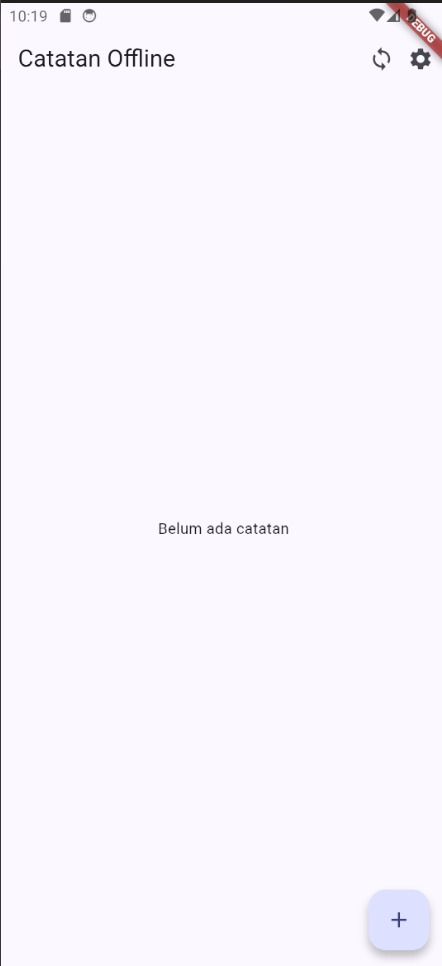</td>
    <td align="center" valign="top">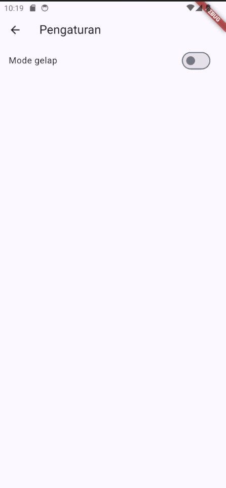</td>
    <td align="center" valign="top">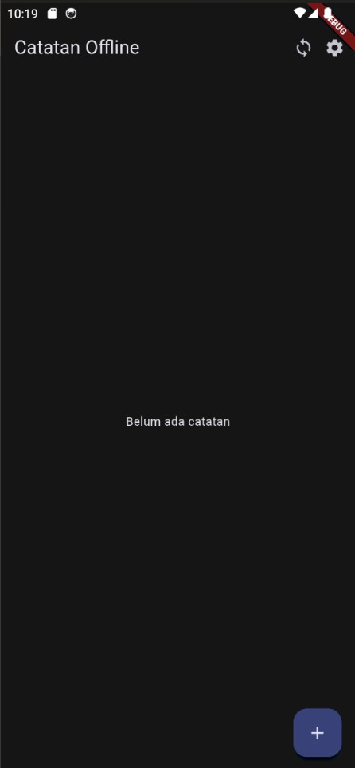</td>
  </tr>
</table>

Setelah toggle "Mode gelap" dinyalakan, seluruh aplikasi berpindah ke tema gelap, dan nilainya tetap tersimpan walaupun aplikasi dijalankan ulang.

---

## 3. Praktikum 2 — SQLite dan repository catatan

`NoteRepository` menangani tambah, baca (`ORDER BY updated_at DESC`), hapus, dan `countDirty()`. Catatan baru selalu disimpan dengan `dirty = 1` karena belum pernah dikirim ke server. Ikon awan dicoret berarti belum sinkron, awan centang berarti sudah sinkron, dan badge pada tombol sync menampilkan jumlah catatan dirty.

<table border="1" align="center" width="100%">
  <tr>
    <th align="center" width="33%">Tambah catatan</th>
    <th align="center" width="33%">Tersimpan (dirty, badge 1)</th>
    <th align="center" width="33%">Hapus catatan</th>
  </tr>
  <tr>
    <td align="center" valign="top">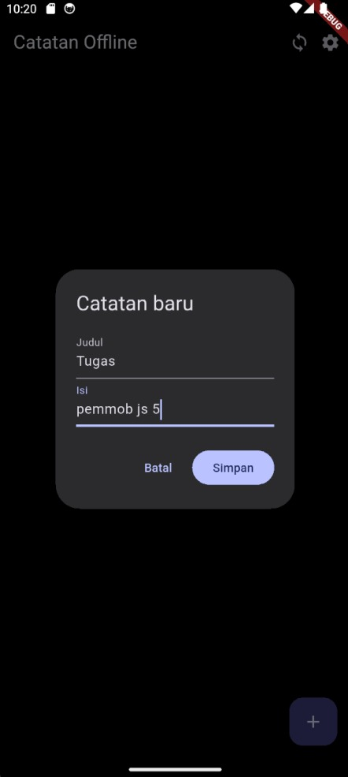</td>
    <td align="center" valign="top">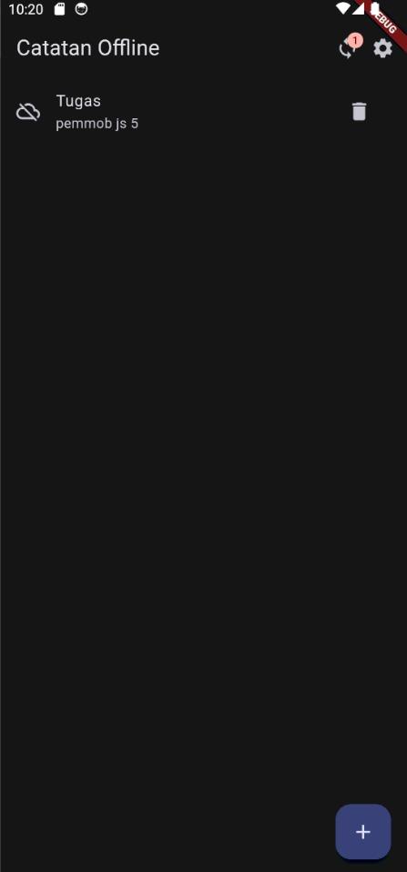</td>
    <td align="center" valign="top">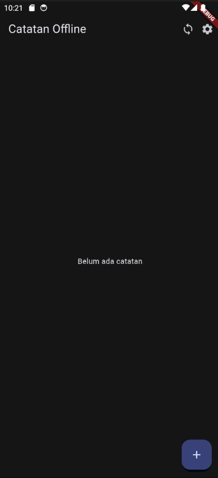</td>
  </tr>
</table>

### Uji persistensi dan mode pesawat

<table border="1" align="center" width="100%">
  <tr>
    <th align="center" width="33%">Catatan baru (PCVK)</th>
    <th align="center" width="33%">Mode pesawat, data tetap ada</th>
    <th align="center" width="33%">Mode pesawat, Posts tersedia</th>
  </tr>
  <tr>
    <td align="center" valign="top">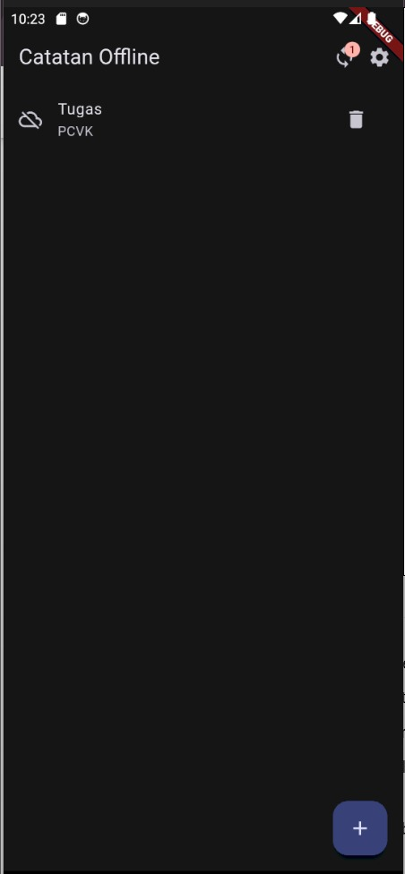</td>
    <td align="center" valign="top">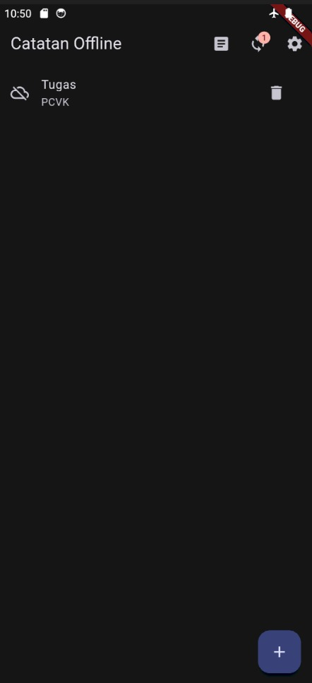</td>
    <td align="center" valign="top"></td>
  </tr>
</table>

Dalam mode pesawat, catatan tetap tampil dan badge dirty tetap akurat (**1**) karena data dibaca dari SQLite, bukan dari jaringan. Menambah catatan baru dalam mode pesawat juga berhasil.

---

## 4. Praktikum 3 — Cache-first dan antrean sync

### 4.1 Posts cache-first

Alur `loadPostsCacheFirst()`:

1. Baca `cached_posts` dan tampilkan seketika.
2. Jika tidak offline, ambil data terbaru dari API (Dio) di background.
3. Simpan hasilnya ke cache, lalu perbarui tampilan.

Bila cache masih kosong (pertama kali dibuka), aplikasi menunggu jaringan; bila gagal, daftar tetap berisi cache yang ada. Toggle **Offline** (`forceOffline`) melewati langkah 2 sehingga perilaku offline dapat didemonstrasikan secara deterministik tanpa mematikan koneksi.

<table border="1" align="center" width="100%">
  <tr>
    <th align="center" width="33%">Online: data dari API</th>
    <th align="center" width="33%">Toggle Offline: banner cache</th>
    <th align="center" width="33%">Mode pesawat: dari cache</th>
  </tr>
  <tr>
    <td align="center" valign="top">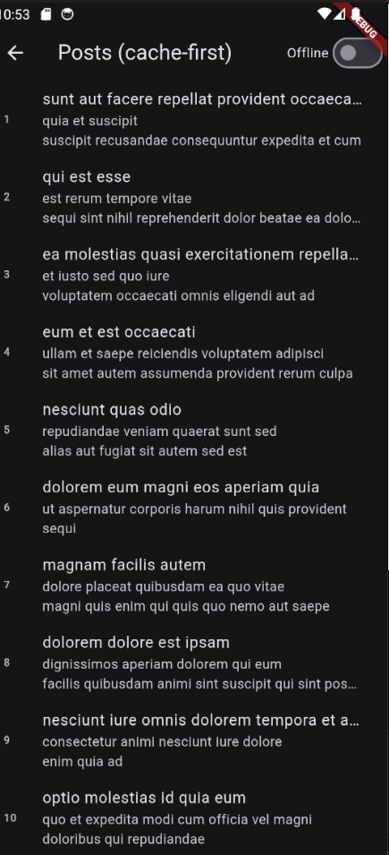</td>
    <td align="center" valign="top">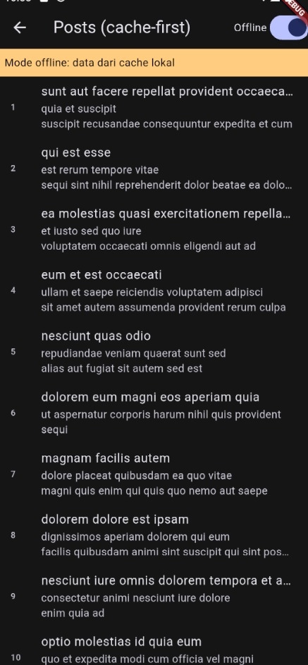</td>
    <td align="center" valign="top">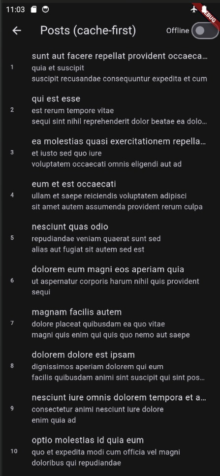</td>
  </tr>
</table>

Saat online, 10 posts tampil dan disimpan ke cache. Saat toggle Offline menyala muncul banner "Mode offline: data dari cache lokal", dan dalam mode pesawat sungguhan daftar tetap tampil dari `cached_posts`.

### 4.2 Sinkronisasi catatan dirty

Alur saat tombol sync ditekan:

1. `_sync()` memeriksa `forceOfflineProvider`. Jika aktif, sync ditunda dengan snackbar **"Offline: sync ditunda"** dan data tidak berubah.
2. Jika tidak offline, `syncNotes()` mengambil id semua catatan dirty lewat `dirtyIds()`. Bila kosong, snackbar menampilkan "Tidak ada catatan untuk disinkronkan".
3. Pengiriman ke server disimulasikan dengan `Future.delayed(1 detik)`.
4. `markSynced(ids)` mengosongkan flag dirty **hanya untuk id yang tadi diambil**.
5. Fungsi mengembalikan `ids.length`, dan snackbar menampilkan "N catatan tersinkron".

<table border="1" align="center" width="100%">
  <tr>
    <th align="center" width="33%">Sebelum: 2 catatan tersinkron</th>
    <th align="center" width="33%">Offline: sync ditunda</th>
    <th align="center" width="33%">Setelah online: sync berhasil</th>
  </tr>
  <tr>
    <td align="center" valign="top">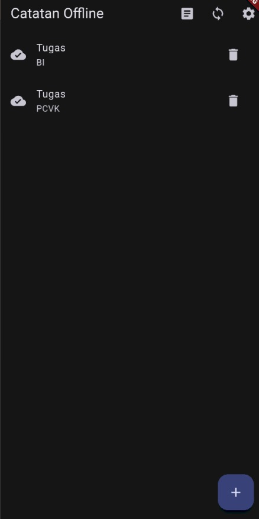</td>
    <td align="center" valign="top">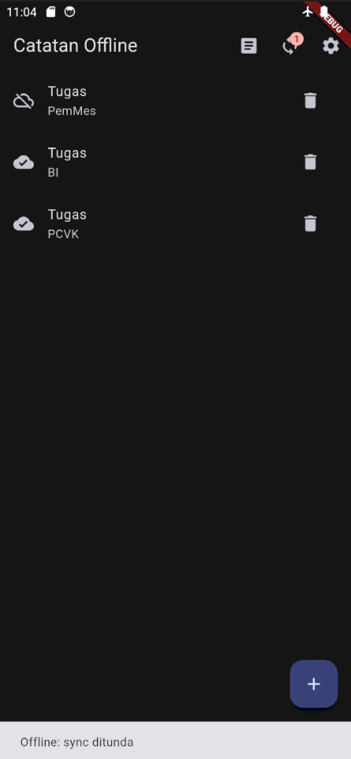</td>
    <td align="center" valign="top">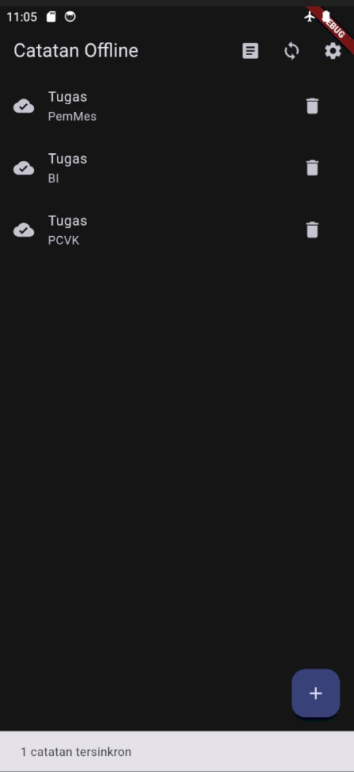</td>
  </tr>
</table>

Saat offline, catatan "PemMes" dibuat dengan status dirty (badge **1**) dan tombol sync hanya menampilkan "Offline: sync ditunda". Setelah koneksi kembali, sync menampilkan **"1 catatan tersinkron"**, semua ikon menjadi awan centang, dan badge kembali ke 0.

Status offline untuk sync ditentukan oleh toggle **Offline**, bukan deteksi koneksi sungguhan, karena server hanya simulasi lokal. Karena itu sync tertunda diuji lewat toggle, sedangkan mode pesawat dipakai untuk menguji baca-tulis SQLite dan cache posts.

### Aturan konflik

Aturan yang dipakai adalah **last-write-wins berdasarkan `updated_at`**: bila data yang sama berubah di dua sisi, versi dengan `updated_at` terbaru dipertahankan. Karena sync hanya satu arah (lokal ke server simulasi) dan aplikasi belum punya fitur edit, aturan ini baru didokumentasikan sebagai dasar untuk backend sungguhan.

---

## 5. Perbaikan setelah verifikasi dan review kode

| Perbaikan | Letak | Alasan |
|---|---|---|
| Indeks `idx_notes_updated` dan `idx_notes_dirty`, versi database 2 dengan `onUpgrade` | `db.dart` | Temuan verifikasi AI: skema awal belum memakai indeks. `onUpgrade` menambah indeks pada database lama tanpa menghapus data |
| `dirtyIds()` + `markSynced(ids)` menggantikan `markAllSynced()` | `note_repository.dart`, `sync.dart` | `markAllSynced()` mengosongkan flag semua baris dirty, sehingga catatan yang dibuat selama jeda sync berisiko ikut ditandai tersinkron padahal belum terkirim |
| Snackbar saat catatan disimpan dan pesan khusus bila antrean kosong | `notes_page.dart` | Umpan balik yang jelas, menggantikan pesan "0 catatan tersinkron" |

<table border="1" align="center" width="100%">
  <tr>
    <th align="center" width="33%">Catatan disimpan, belum sinkron</th>
    <th align="center" width="33%">Toggle Offline: sync ditunda</th>
    <th align="center" width="33%">Toggle mati: sync berhasil</th>
  </tr>
  <tr>
    <td align="center" valign="top">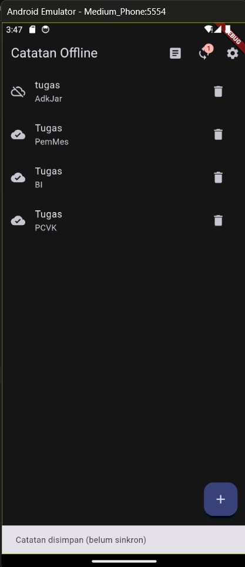</td>
    <td align="center" valign="top">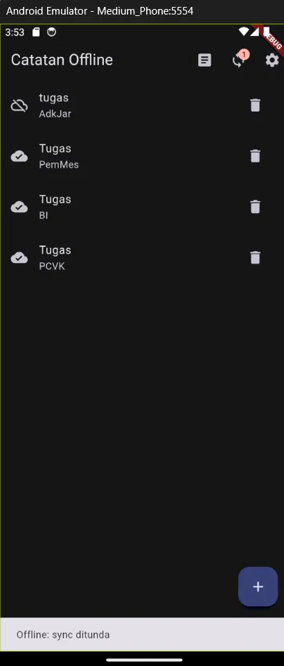</td>
    <td align="center" valign="top">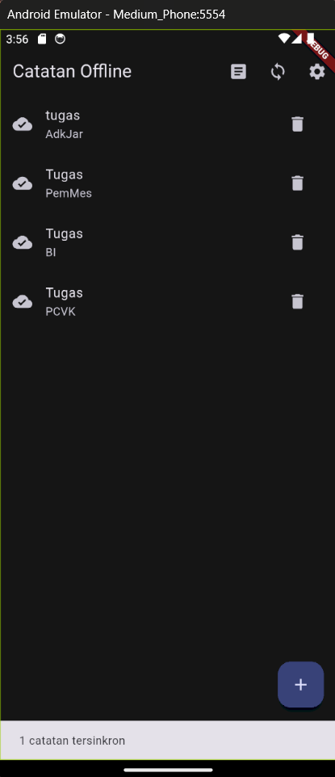</td>
  </tr>
</table>

Setelah perbaikan, skenario diuji ulang di emulator Android (API 34): data catatan lama tetap utuh setelah database naik ke versi 2, sync tertunda saat toggle Offline menyala, dan sync berhasil saat toggle mati dengan badge kembali ke 0.

### Keterbatasan

- Status offline manual lewat toggle `forceOffline`; pengembangan lanjutan bisa memakai `connectivity_plus`.
- Sync satu arah dan server simulasi, tanpa penanganan error jaringan di tengah sync, retry, atau backoff.
- `deleteNote()` memakai hard delete sehingga penghapusan belum bisa disinkronkan; backend sungguhan membutuhkan soft delete (misalnya kolom `deleted_at`).
- sqflite tidak punya stream bawaan, jadi daftar diperbarui lewat `ref.invalidate` / `invalidateSelf`.

---

## 6. AI Challenge

**Tool AI:** Claude (ekstensi VS Code)

### Prompt yang digunakan

```
Aplikasi Flutter Offline Notes: CRUD catatan + preferensi tema.
Bandingkan SharedPreferences, Hive, sqflite (SQLite), dan Drift
untuk dua kebutuhan ini. Requirements:
- Kriteria: kompleksitas query, kebutuhan relasi, reaktivitas (stream),
  type-safety, ukuran boilerplate, dan kemudahan testing.
- Beri rekomendasi final: mana untuk preferensi, mana untuk catatan,
  beserta alasannya dalam 1 tabel.
- Tunjukkan skema tabel/kotak untuk 1000+ catatan.
Jelaskan trade-off setiap pilihan.
```

AI merekomendasikan SharedPreferences untuk preferensi dan **Drift** untuk catatan (sqflite sebagai alternatif bila ingin dependensi seminimal mungkin), lengkap dengan skema tabel dan dua indeks.

### Hasil verifikasi

| # | Pertanyaan verifikasi | Temuan |
|---|---|---|
| 1 | Apakah AI menaruh daftar catatan di SharedPreferences? | Tidak. Preferensi di SharedPreferences, catatan di database (SQLite lewat Drift atau sqflite). Sesuai keputusan saya karena SharedPreferences tidak punya query dan rapuh untuk koleksi |
| 2 | Apakah skema mendukung antrean sync (`dirty` / `updated_at`)? | Ya, skema AI punya penanda sync (`is_dirty`) dan `updated_at`, tetapi tidak persis sama dengan `db.dart`: AI memakai epoch millis dan kolom tambahan (`created_at`, `is_pinned`, `is_deleted`), sedangkan saya memakai `dirty` dan `updated_at` ISO-8601. AI juga menyarankan indeks (`idx_notes_list`, `idx_notes_dirty`) yang awalnya belum saya pakai; sekarang saya tambahkan `idx_notes_updated` dan `idx_notes_dirty` lewat versi database 2 dan `onUpgrade` |
| 3 | Apakah klaim "real-time" didukung stream? | Sesuai dokumentasi: Drift punya `watch()`, Hive punya `box.watch()`, sqflite tidak punya stream bawaan |
| 4 | Apakah estimasi boilerplate masuk akal? | sqflite saya buktikan sendiri (cukup `sqflite` + `path`, SQL string, `toMap`/`fromMap`). Drift hanya diperiksa lewat dokumentasi: butuh `drift`, `drift_flutter`, `drift_dev`, `build_runner`, dan file `.g.dart` |
| 5 | Keputusan final | AI merekomendasikan SharedPreferences untuk preferensi dan **Drift** untuk catatan, dengan sqflite sebagai alternatif. Saya mengikuti AI untuk preferensi, tetapi memilih **sqflite** untuk catatan: hanya ada satu tabel dengan antrean sync, sehingga code generation dan migrasi Drift tidak sebanding. Konsekuensinya, UI di-refresh manual lewat `ref.invalidate` |

Review kode dan perbandingan dengan jawaban AI menemukan beberapa hal tambahan:

- `markAllSynced()` tidak dibahas AI dan berisiko menandai catatan baru sebagai tersinkron padahal belum terkirim (diperbaiki, lihat bagian 5).
- Skema AI sudah memakai soft delete (`is_deleted`), sedangkan `deleteNote()` di aplikasi saya memakai hard delete sehingga penghapusan belum bisa disinkronkan (dicatat sebagai keterbatasan).
- AI menyarankan key preferensi `theme_mode` (`system` / `light` / `dark`); aplikasi saya memakai `dark_mode` (bool) dan `last_opened_at`, karena hanya butuh terang atau gelap.
- Saran pagination (`LIMIT/OFFSET`) dan FTS5 belum diterapkan di aplikasi ini.

Dokumentasi lengkap ada di folder `docs/`:

- [Prompt](docs/01-prompt.md)
- [Output AI (Claude)](docs/02-output-awal-ai.md)
- [Hasil verifikasi](docs/03-hasil-verifikasi.md)
- [Hasil testing](docs/04-hasil-testing.md)

---

## 7. Testing

Tes bawaan Flutter (`widget_test.dart`, aplikasi counter) tidak sesuai dengan aplikasi ini sehingga dihapus dan diganti `test/note_repository_test.dart`. Tes memakai database SQLite in-memory (`sqflite_common_ffi`) yang disuntikkan lewat parameter `openDb`, sehingga tidak perlu emulator dan tidak menyentuh database asli.

| # | Tes | Yang dibuktikan |
|---|---|---|
| 1 | `addNote` menyimpan catatan dengan `dirty = true` | Catatan baru masuk antrean sync |
| 2 | `fetchNotes` mengurutkan dari `updated_at` terbaru | `ORDER BY updated_at DESC` bekerja |
| 3 | `deleteNote` menghapus catatan | Baris dan hitungan dirty ikut berkurang |
| 4 | `markSynced` hanya menandai id yang diberikan | Catatan lain tetap dirty |
| 5 | Catatan baru setelah `dirtyIds()` tetap dirty | Perbaikan risiko balapan pada sync |
| 6 | `syncNotes` mengembalikan jumlah dan mengosongkan antrean | Alur sync lengkap |
| 7 | `syncNotes` mengembalikan 0 bila tidak ada catatan dirty | Kasus antrean kosong |

```
flutter analyze
No issues found!

flutter test
00:04 +7: All tests passed!
```

Cakupan tes terbatas pada `NoteRepository` dan `syncNotes()`; halaman UI, `PostRepository`, dan `PrefsRepository` diuji manual di emulator.

---

## 8. Checklist verifikasi mandiri

- [x] Widget tidak mengakses SQLite atau SharedPreferences langsung; semua lewat repository
- [x] Catatan dan preferensi tetap ada setelah aplikasi ditutup dan dalam mode pesawat
- [x] Posts tampil dari cache saat offline, dengan banner penanda
- [x] Sync tertunda saat offline dan hanya menandai catatan yang benar-benar dikirim
- [x] Database naik versi tanpa menghapus data lama
- [x] `flutter analyze` tanpa issue dan seluruh test lulus
- [x] Hasil AI diverifikasi dan didokumentasikan pada folder `docs/`
