# Week 6 — Authentication, Security & FCM (`campus_notify`)

Aplikasi Flutter **Campus Notify**: login dengan penyimpanan token aman, refresh token otomatis lewat interceptor, guard rute, serta notifikasi push Firebase Cloud Messaging (FCM) yang dapat membuka halaman pengumuman dari tiga kondisi aplikasi (foreground, background, terminated) dan dari topik broadcast. Proyek ini mencakup tiga praktikum (login + secure storage + token refresh, FCM + permission + token lifecycle, payload + tiga app state + topik), perbaikan kendala, AI challenge, dan testing.

| Item | Keterangan |
|---|---|
| Penyimpanan token | `flutter_secure_storage` (bukan `SharedPreferences`) |
| HTTP client | Dio dengan interceptor refresh token |
| Autentikasi | Mock siap diganti Firebase Auth / Google Sign-In |
| Routing | `go_router` dengan guard `redirect` dan `refreshListenable` |
| State management | Riverpod (`AsyncNotifierProvider`, `Provider`) |
| Push notification | `firebase_core`, `firebase_messaging`, `flutter_local_notifications` |
| Package Android | `com.example.campus_notify` |
| Perangkat uji | Emulator Android (API 34) dan HP Android |

---

## 1. Struktur proyek dan keputusan arsitektur

```
campus_notify/
├── android/app/google-services.json   # dari Firebase Console (tidak di-commit)
└── lib/
    ├── main.dart                      # inisialisasi Firebase, router, MyApp
    ├── data/
    │   ├── token_store.dart           # satu-satunya pintu token (secure storage)
    │   ├── auth_repository.dart       # login & refresh (mock)
    │   └── api_client.dart            # Dio + interceptor refresh 401
    ├── providers/
    │   └── auth_provider.dart         # tokenStore, authRepository, dio, authState
    ├── messaging/
    │   ├── background_handler.dart    # handler background FCM (@pragma vm:entry-point)
    │   └── push_service.dart          # izin, token FCM, handler 3 state, topik
    └── pages/
        ├── login_page.dart
        ├── home_page.dart
        ├── announcement_page.dart
        └── debug_page.dart            # token FCM terpotong, jumlah sync, topik
```

| Kebutuhan | Pilihan | Alasan |
|---|---|---|
| Access dan refresh token | `flutter_secure_storage` | Tersimpan terenkripsi (Keystore/Keychain). `SharedPreferences` tidak terenkripsi sehingga tidak aman untuk token |
| Akses token | Hanya lewat `TokenStore` | Satu titik kontrol; widget dan interceptor tidak menyentuh storage langsung |
| Banner notifikasi saat foreground | `flutter_local_notifications` | Sistem tidak menampilkan banner otomatis saat aplikasi terbuka, jadi ditampilkan manual |
| Broadcast (semua mahasiswa, satu kelas, UKM) | Topik FCM `pengumuman-kampus` | Satu kiriman untuk banyak perangkat |
| Pesan personal (nilai, tagihan) | Token perangkat | Topik bersifat publik bagi semua pelanggan |
| Navigasi dari notifikasi | Field `route` di `data` payload | Tujuan halaman ditentukan backend, bukan di-hardcode di aplikasi |

Payload memakai gabungan `notification` dan `data`. Pesan `notification` ditampilkan sistem saat background atau terminated, sedangkan `data` membawa `route` agar klik membuka halaman yang benar. Pesan hanya-`data` tidak ditampilkan otomatis di Android sehingga harus diproses manual.

---

## 2. Praktikum 1 — Login, secure storage, token refresh

**Alur login:** `AuthNotifier.login()` memanggil `AuthRepository.login()` (mock: email harus berisi `@` dan sandi minimal 6 karakter), lalu menyimpan access dan refresh token lewat `TokenStore`. `AuthNotifier.build()` membaca access token saat aplikasi dibuka, sehingga sesi bertahan setelah aplikasi ditutup.

**Refresh token:** interceptor Dio menambahkan header `Authorization: Bearer <access>` pada tiap request. Saat menerima 401, interceptor mencoba refresh satu kali dan mengulang request. Jika refresh gagal, token dihapus dan pengguna dipaksa login ulang.

**Guard rute:** `routerProvider` memakai `ref.listen` pada `authStateProvider` dan `refreshListenable`. Tanpa itu, `redirect` hanya berjalan saat navigasi sehingga layar tidak berpindah otomatis setelah login atau logout.

<table border="1" align="center" width="100%">
  <tr>
    <th align="center" width="33%">Login gagal</th>
    <th align="center" width="33%">Login berhasil (token terpotong)</th>
    <th align="center" width="33%">Sesi bertahan setelah restart</th>
  </tr>
  <tr>
    <td align="center" valign="top">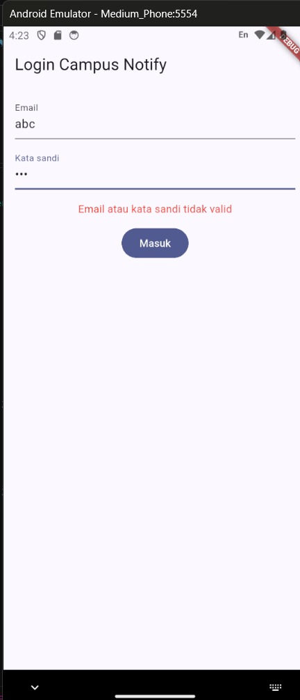</td>
    <td align="center" valign="top"></td>
    <td align="center" valign="top">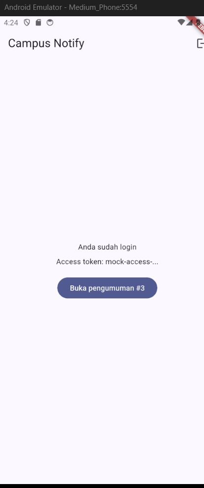</td>
  </tr>
</table>

<table border="1" align="center" width="66%">
  <tr>
    <th align="center" width="50%">Logout kembali ke Login</th>
    <th align="center" width="50%">Navigasi ke Pengumuman #3</th>
  </tr>
  <tr>
    <td align="center" valign="top">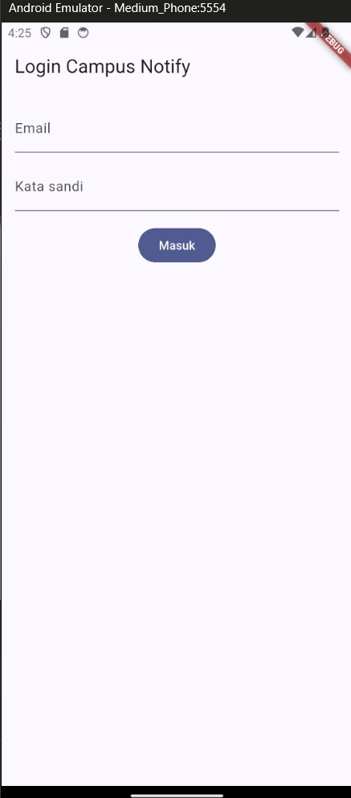</td>
    <td align="center" valign="top">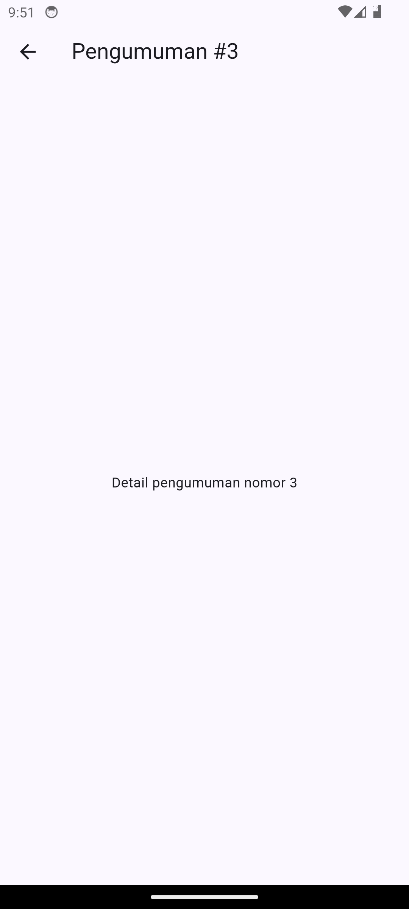</td>
  </tr>
</table>

Email tanpa `@` atau sandi kurang dari 6 karakter menampilkan pesan error merah. Setelah login valid, Home menampilkan access token yang hanya tampil 12 karakter pertama. Setelah restart, aplikasi langsung ke Home karena token dibaca dari secure storage, dan ikon logout menghapus token lalu kembali ke Login.

---

## 3. Praktikum 2 — FCM, permission, token lifecycle

**Setup Firebase:** project `campus-notify` dibuat di Firebase Console, aplikasi Android didaftarkan dengan package `com.example.campus_notify`, dan `google-services.json` diletakkan di `android/app/`. Plugin `com.google.gms.google-services` diaktifkan di `settings.gradle.kts` dan `app/build.gradle.kts`, izin `POST_NOTIFICATIONS` ditambahkan di `AndroidManifest.xml`, dan `Firebase.initializeApp()` dipanggil sebelum `runApp`.

**Token lifecycle** (`initFcmToken`):

1. Ambil token saat ini lewat `getToken()` dan kirim ke backend.
2. Dengarkan `onTokenRefresh` karena token dapat berubah (pasang ulang, hapus data, rotasi keamanan). Tanpa listener ini backend menyimpan token basi.
3. Subscribe topik `pengumuman-kampus`.

Halaman **Debug FCM** menampilkan token terpotong 12 karakter, jumlah pengiriman ke backend, dan topik. Token penuh tidak pernah ditampilkan di UI maupun laporan. Pengiriman ke backend (`POST /devices`) masih disimulasikan: `tokenSyncCount` bertambah dan log `[MOCK] token dikirim ke backend (...)` tercetak.

<table border="1" align="center" width="100%">
  <tr>
    <th align="center" width="33%">Dialog izin notifikasi</th>
    <th align="center" width="33%">Token awal (Debug FCM)</th>
    <th align="center" width="33%">Token baru setelah pasang ulang</th>
  </tr>
  <tr>
    <td align="center" valign="top">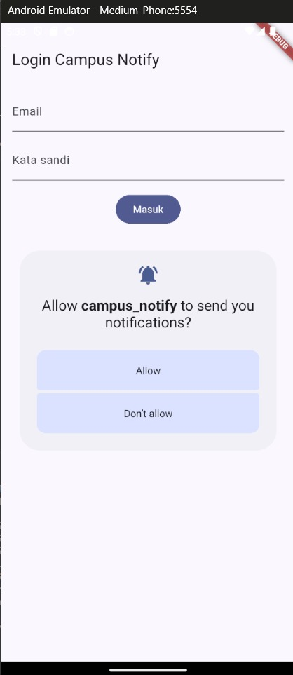</td>
    <td align="center" valign="top">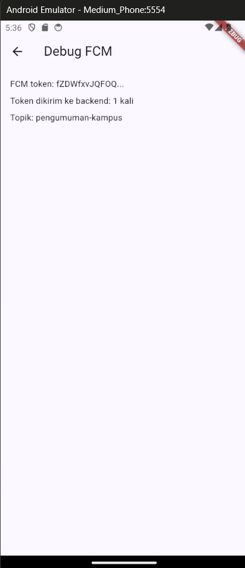</td>
    <td align="center" valign="top">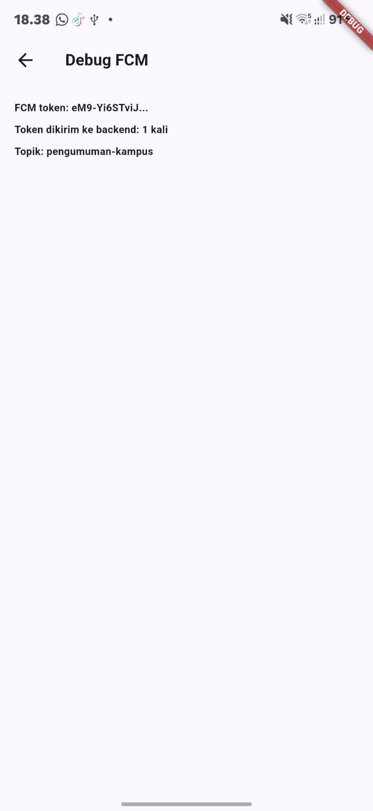</td>
  </tr>
</table>

Token awal dan token sesudah pemasangan ulang berbeda, membuktikan token dapat berubah dan listener `onTokenRefresh` wajib ada.

<table border="1" align="center" width="33%">
  <tr>
    <th align="center">Notifikasi dari Firebase Console</th>
  </tr>
  <tr>
    <td align="center" valign="top">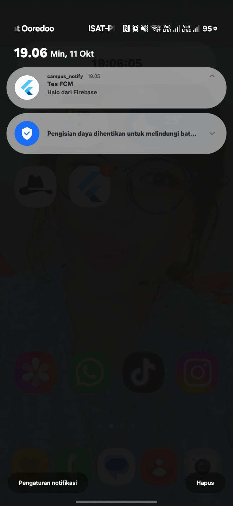</td>
  </tr>
</table>

<table border="1" align="center" width="66%">
  <tr>
    <th align="center">Log token dikirim ke backend (mock)</th>
  </tr>
  <tr>
    <td align="center" valign="top">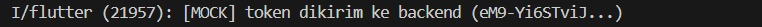</td>
  </tr>
</table>

Kampanye uji dari Firebase Console dikirim saat aplikasi berada di background; banner sistem muncul dan klik membuka aplikasi.

---

## 4. Praktikum 3 — Payload, tiga app state, klik, topik

Payload yang dipakai pada seluruh pengujian:

```json
{
  "notification": {
    "title": "Jadwal kuliah berubah",
    "body": "Kelas Mobile pindah ke Ruang A2 jam 13.00"
  },
  "data": { "route": "/pengumuman/3", "id": "3" }
}
```

Di Firebase Console, `route` dan `id` diisi pada **Additional options > Custom data**.

| State | Mekanisme di kode |
|---|---|
| Foreground | `FirebaseMessaging.onMessage` lalu banner ditampilkan manual lewat `flutter_local_notifications` dengan `payload = route`; klik memanggil `navigate(route)` |
| Background | Banner sistem otomatis; klik ditangani `FirebaseMessaging.onMessageOpenedApp` |
| Terminated | `FirebaseMessaging.instance.getInitialMessage()` dibaca saat aplikasi dibuka dari notifikasi |
| Handler background | `firebaseMessagingBackgroundHandler` berstatus top-level dengan `@pragma('vm:entry-point')` karena berjalan di isolate terpisah, dan tidak mengakses `BuildContext` atau Riverpod |

### Matriks pengujian

| State | Yang diharapkan | Cara uji | Hasil |
|---|---|---|---|
| Foreground | Banner lokal muncul, klik masuk ke `/pengumuman/3` | Aplikasi terbuka dan login, kirim dari Console | Berhasil |
| Background | Banner sistem muncul, klik masuk ke rute yang benar | Tekan Home, kirim, klik banner | Berhasil |
| Terminated | Aplikasi terbuka ke rute yang benar via `getInitialMessage` | Swipe-close dari Recents (bukan Force stop), kirim, klik banner | Berhasil |
| Topik | Pesan ke `pengumuman-kampus` sampai ke perangkat yang subscribe | Campaign dengan target Topic | Berhasil |

### Foreground

<table border="1" align="center" width="66%">
  <tr>
    <th align="center" width="50%">Banner lokal muncul</th>
    <th align="center" width="50%">Klik membuka Pengumuman #3</th>
  </tr>
  <tr>
    <td align="center" valign="top">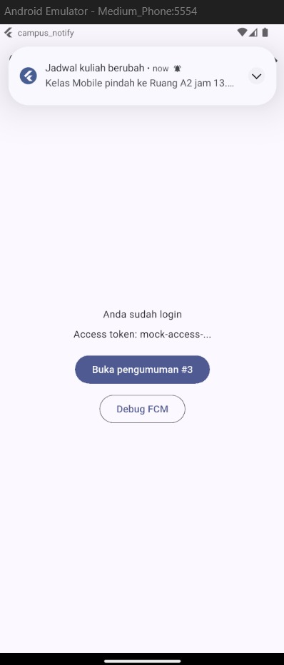</td>
    <td align="center" valign="top">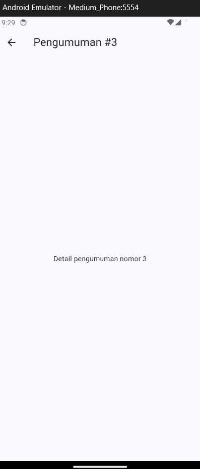</td>
  </tr>
</table>

### Background

<table border="1" align="center" width="66%">
  <tr>
    <th align="center" width="50%">Banner sistem di home screen</th>
    <th align="center" width="50%">Klik membuka Pengumuman #3</th>
  </tr>
  <tr>
    <td align="center" valign="top">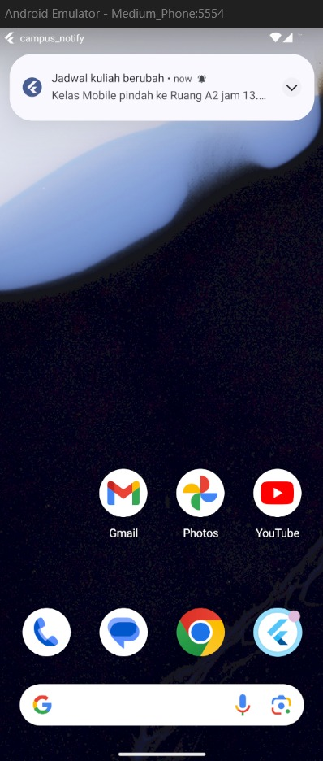</td>
    <td align="center" valign="top">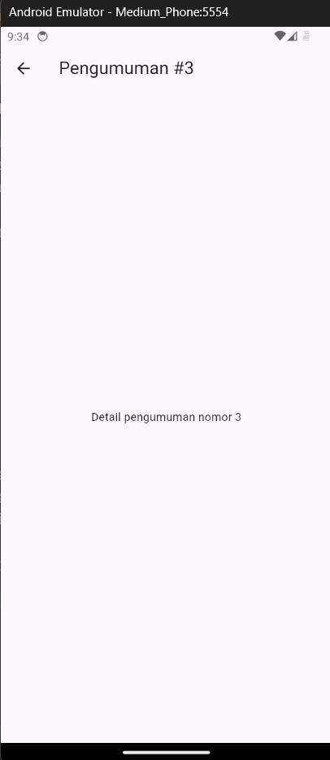</td>
  </tr>
</table>

### Terminated

<table border="1" align="center" width="66%">
  <tr>
    <th align="center" width="50%">Banner saat aplikasi tertutup</th>
    <th align="center" width="50%">Langsung terbuka di Pengumuman #3</th>
  </tr>
  <tr>
    <td align="center" valign="top">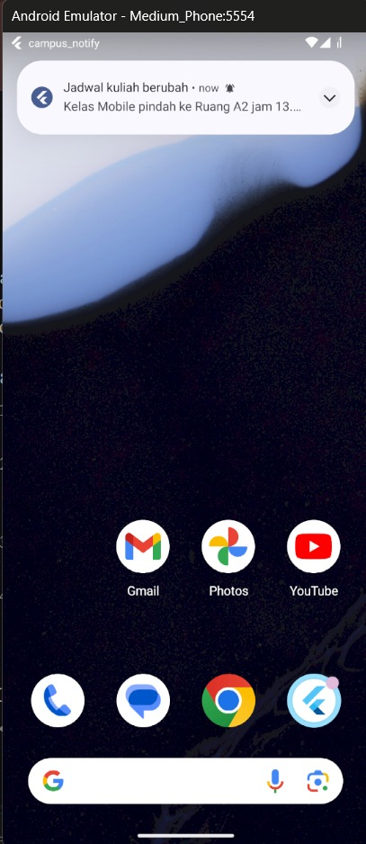</td>
    <td align="center" valign="top">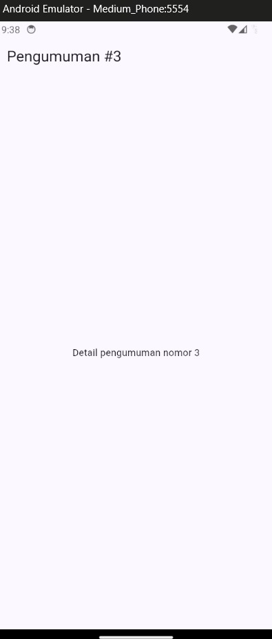</td>
  </tr>
</table>

Pada state terminated, halaman Pengumuman #3 tidak memiliki tombol back karena aplikasi dibuka langsung ke rute tersebut lewat `router.go`, tanpa Home di bawahnya. Pada foreground dan background, tombol back muncul karena Home sudah ada di tumpukan halaman.

### Topik

<table border="1" align="center" width="66%">
  <tr>
    <th align="center" width="50%">Banner dari topik <code>pengumuman-kampus</code></th>
    <th align="center" width="50%">Klik membuka Pengumuman #3</th>
  </tr>
  <tr>
    <td align="center" valign="top">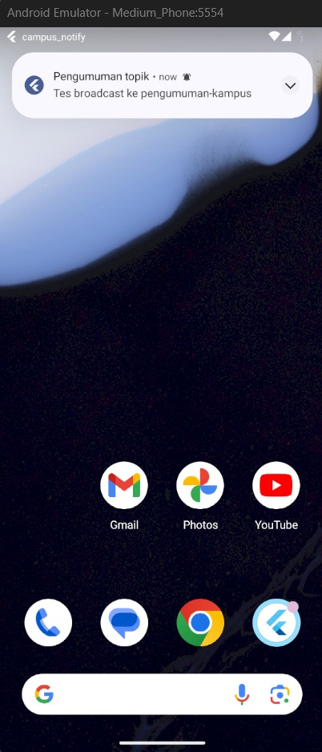</td>
    <td align="center" valign="top">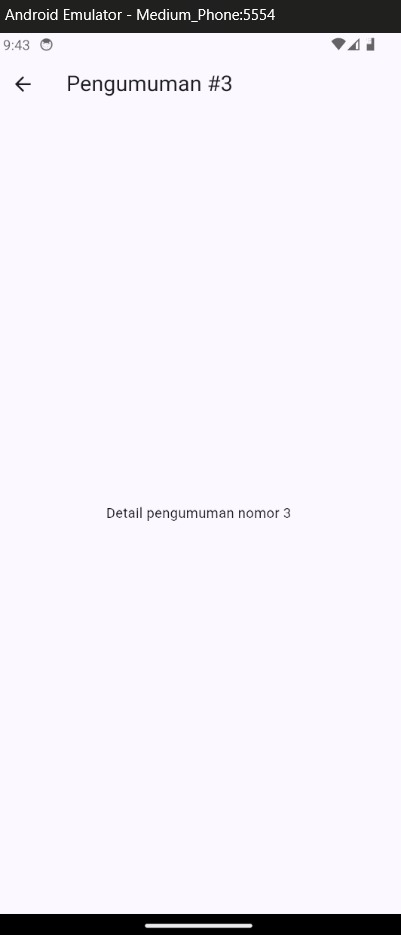</td>
  </tr>
</table>

Campaign dengan target **Topic** `pengumuman-kampus` sampai ke perangkat yang sudah subscribe saat aplikasi pertama kali berjalan. Topik dipakai untuk broadcast, sedangkan pesan personal memakai token perangkat.

---

## 5. Kendala dan perbaikan

| Kendala | Letak | Perbaikan |
|---|---|---|
| Build gagal: `requires core library desugaring` | `android/app/build.gradle.kts` | Aktifkan `isCoreLibraryDesugaringEnabled = true` dan tambah `coreLibraryDesugaring("com.android.tools:desugar_jdk_libs:2.1.4")` |
| `flutter_secure_storage` butuh SDK lebih tinggi | `build.gradle.kts` | `minSdk = 23` |
| Panel Problems penuh error pada `main.dart` dan `auth_provider.dart` | `lib/` | Potongan kode modul hanya fragmen: ditambah `import`, `main()`, dan provider `tokenStoreProvider`, `authRepositoryProvider`, `dioProvider` |
| Layar tidak berpindah otomatis setelah login | `main.dart` | Router dibuat sebagai provider dengan `refreshListenable` yang dipicu `ref.listen(authStateProvider)` |
| Layar emulator hitam (`Unable to match the desired swap behavior`) | Emulator | Dijalankan dengan `-gpu swiftshader_indirect` (rendering software) |
| Gradle gagal karena versi plugin Android tidak dikenal | `settings.gradle.kts` | Versi AGP asli diambil dari template `flutter create`, lalu ditambahkan plugin `com.google.gms.google-services` |
| `build.gradle.kts` root tertukar isinya dengan file app | `android/` | Isi kedua file dikembalikan; plugin Google Services hanya di `settings.gradle.kts` dan `app/build.gradle.kts` |
| `_local.initialize` dan `_local.show` error | `push_service.dart` | Versi terbaru `flutter_local_notifications` memakai parameter bernama (`settings:`, `id:`, `title:`, `body:`, `notificationDetails:`) |
| Nama package terbentuk `campu_notify` | Android | Diganti ke `com.example.campus_notify`: `namespace` dan `applicationId`, folder Kotlin dan `package` di `MainActivity.kt`, aplikasi baru di Firebase, dan `google-services.json` diganti |
| Aplikasi crash setelah ganti package | `MainActivity` | Nama folder dan `package` di `MainActivity.kt` harus sama dengan `applicationId` |
| Notifikasi tidak muncul di awal pengujian | Emulator | Emulator di-boot ulang dengan cold boot dan internet dipastikan aktif; notifikasi kemudian diterima normal |

### Keterbatasan

- Backend belum ada: `POST /devices` dan endpoint refresh token masih mock, sehingga alur 401, refresh, lalu ulangi request belum diuji end-to-end (alurnya sudah ada di interceptor). Pengiriman token FCM ke server hanya disimulasikan lewat `tokenSyncCount` dan log `[MOCK]`.
- Token login mock bukan JWT sungguhan. Di produksi, token dibuat dan diverifikasi server.
- Pengujian dan konfigurasi hanya untuk Android (emulator). Konfigurasi iOS (`GoogleService-Info.plist`, kunci APNs) tidak dikerjakan.
- Saat logout, langganan topik dibatalkan, tetapi token FCM belum dihapus dari backend (backend belum ada).
- Subscribe topik `pengumuman-kampus` terjadi setiap aplikasi dijalankan, termasuk sebelum login, sehingga pengguna yang sudah logout akan subscribe lagi pada peluncuran berikutnya. Solusi sungguhan: subscribe hanya setelah login.
- Notifikasi yang diklik saat pengguna belum login diarahkan ke halaman Login oleh guard, dan tujuan awalnya (`/pengumuman/3`) tidak diingat setelah login.
- Pesan yang dikirim saat aplikasi di-Force stop tidak diterima sampai aplikasi dibuka lagi (perilaku Android), sehingga uji terminated memakai swipe dari Recents.
- Pengiriman FCM dapat tertunda beberapa detik hingga satu menit, terutama di emulator dengan rendering software.
- Banner foreground bergantung pada `flutter_local_notifications`; tampilannya dibuat manual dan belum dikustomisasi (ikon, channel, suara).
- `google-services.json` berisi API key proyek Firebase, sehingga tidak di-commit bila repo publik.

---

## 6. AI Challenge

**Tool AI:** Claude

### Prompt yang digunakan

```
Aplikasi Flutter Campus Notification App.
Stack: firebase_messaging, flutter_local_notifications,
flutter_secure_storage, go_router, Riverpod.
Buatkan PushService dengan:
- requestPermission + getToken + onTokenRefresh (kirim ke POST /devices)
- onMessage (tampilkan local notification manual)
- onMessageOpenedApp + getInitialMessage (navigasi ke data.route)
- subscribe/unsubscribe topic pengumuman-kampus
- background handler top-level dengan @pragma('vm:entry-point')
Tandai bagian yang BERBEDA untuk Android 13+ vs iOS,
dan bagian yang tidak boleh mengakses BuildContext.
```

### Hasil verifikasi

| # | Pertanyaan verifikasi | Temuan |
|---|---|---|
| 1 | Background handler top-level dengan `@pragma('vm:entry-point')`? | Ya. `firebaseMessagingBackgroundHandler` berada di level file, tidak mengakses `BuildContext` atau Riverpod, dan hanya mencatat `messageId` |
| 2 | `onTokenRefresh` mengirim token baru ke backend, bukan hanya log? | Sebagian. `getToken` dan `onTokenRefresh` memakai callback `onToken` yang sama (`fcmToken` diperbarui, `tokenSyncCount` bertambah), tetapi `dio.post('/devices')` masih komentar karena backend belum ada, jadi pengiriman sungguhan belum dibuktikan |
| 3 | Foreground memakai local notification manual? | Ya. `onMessage` memanggil `_local.show(...)` dengan `payload = route`. Banner ganda tidak teramati |
| 4 | Klik dari tiga state masuk ke rute yang benar? | Ya setelah perbaikan; lihat matriks pengujian di bagian 4 dan `docs/04-hasil-uji-tiga-state.md` |
| 5 | Token atau secret tidak di-hardcode dan tidak di-log penuh? | Ya dengan catatan. Log dan UI hanya menampilkan 12 karakter pertama; baris `FULL_TOKEN` hanya sementara untuk diagnosis dan dihapus; `google-services.json` tidak di-commit |
| 6 | Keputusan final | Mempertahankan `notification` + `data.route`, topik hanya untuk broadcast, dan backend `/devices` tetap mock sampai server tersedia (alasan lengkap di `docs/03-hasil-verifikasi.md`) |

### Perbaikan manual terhadap draf AI

| # | Masalah draf AI | Perbaikan |
|---|---|---|
| 1 | `initialize` dan `show` memakai parameter posisi, gagal kompilasi pada versi terbaru | Diganti parameter bernama (`settings:`, `id:`, `title:`, `body:`, `notificationDetails:`) |
| 2 | `runApp` menunggu dialog izin dan token selesai | `runApp` dipanggil lebih dulu, push diinisialisasi sesudahnya lewat `_initPush()` |
| 3 | Klik banner foreground hanya menyimpan `pendingDeepLink`, tidak berpindah halaman | Diganti callback `navigate` yang memakai `router.go` |
| 4 | Listener dipasang sebelum router siap | Dipasang di `addPostFrameCallback` pada `MyApp` memakai `routerProvider` |
| 5 | Tidak ada `unsubscribeFromTopic` padahal diminta | Ditambahkan `unsubscribeCampusTopic()` dan dipanggil saat logout |

Draf awal juga tidak menandai perbedaan Android 13+ dan iOS; tabel perbedaannya dilengkapi manual di dokumentasi.

Dokumentasi lengkap ada di folder `docs/`:

- [Prompt](docs/01-prompt.md)
- [Output awal AI](docs/02-output-awal-ai.md)
- [Hasil verifikasi dan perbaikan](docs/03-hasil-verifikasi.md)
- [Hasil uji tiga app state dan topik](docs/04-hasil-uji-tiga-state.md)

---

## 7. Testing

Pengujian aplikasi mencakup unit test untuk `AuthRepository` dan widget test (smoke test) untuk memastikan `LoginPage` tampil saat cold-start tanpa token. Selain itu, pengujian end-to-end dilakukan manual menggunakan matriks tiga state, topik, dan skenario autentikasi pada bagian 2 sampai 4.

| # | File Test | Skenario Pengujian | Hasil |
|:---:|---|---|:---:|
| 1 | `test/auth_repository_test.dart` | Login berhasil dengan kredensial valid (email memiliki `@` dan sandi >= 6 karakter) | Lulus |
| 2 | `test/auth_repository_test.dart` | Login gagal dan melempar Exception jika format email tanpa `@` | Lulus |
| 3 | `test/auth_repository_test.dart` | Login gagal dan melempar Exception jika sandi kurang dari 6 karakter | Lulus |
| 4 | `test/auth_repository_test.dart` | Refresh token menghasilkan token akses baru ketika refresh token valid | Lulus |
| 5 | `test/auth_repository_test.dart` | Refresh token melempar Exception jika refresh token kosong | Lulus |
| 6 | `test/widget_test.dart` | Smoke test: memastikan `LoginPage` (2 TextField + tombol Masuk) tampil tanpa token | Lulus |

### Hasil eksekusi `flutter test` dan `flutter analyze`

```bash
flutter test
```
```text
00:03 +6: All tests passed!
```

```bash
flutter analyze
```
```text
Analyzing campus_notify...
No issues found!
```

---

## 8. Checklist verifikasi mandiri

- [x] Token hanya disimpan di `flutter_secure_storage`, bukan `SharedPreferences`
- [x] Token tidak pernah ditampilkan penuh di UI, log laporan, maupun screenshot
- [x] Sesi bertahan setelah aplikasi ditutup dan logout menghapus token
- [x] Guard rute mengarahkan pengguna yang belum login ke `/login`
- [x] Izin notifikasi diminta saat runtime dan token FCM dipantau lewat `onTokenRefresh`
- [x] Handler background berstatus top-level dengan `@pragma('vm:entry-point')`
- [x] Tiga state (foreground, background, terminated) dan topik diuji dengan payload yang sama
- [x] AI Challenge diverifikasi dan didokumentasikan pada folder `docs/`
- [x] Unit test ditambahkan dan `flutter analyze` bersih