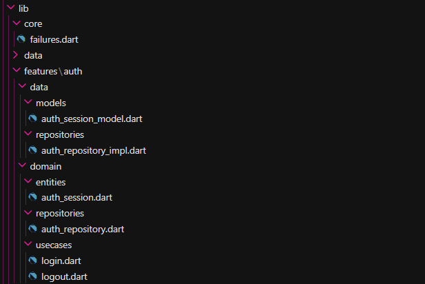
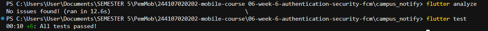
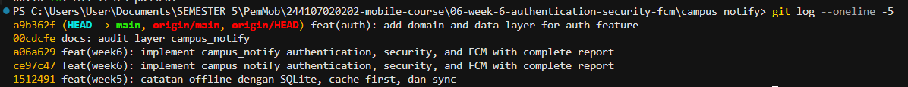
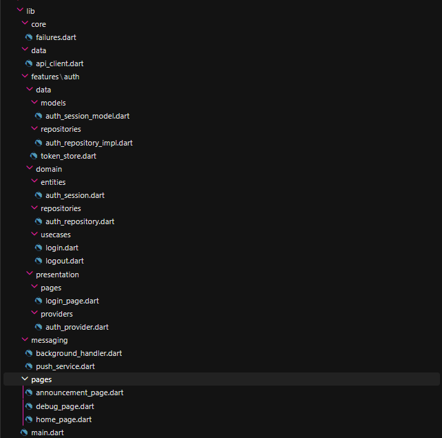
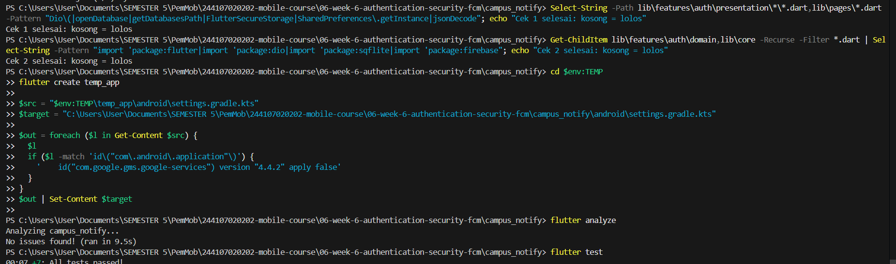
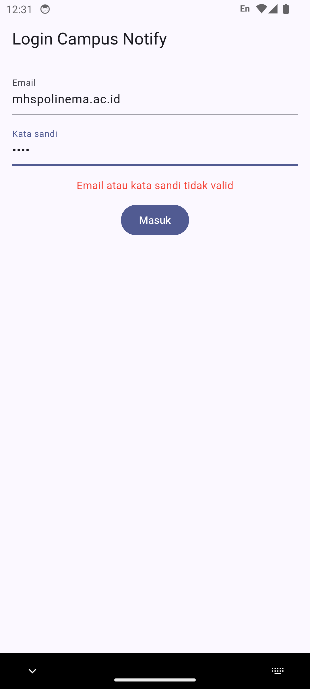
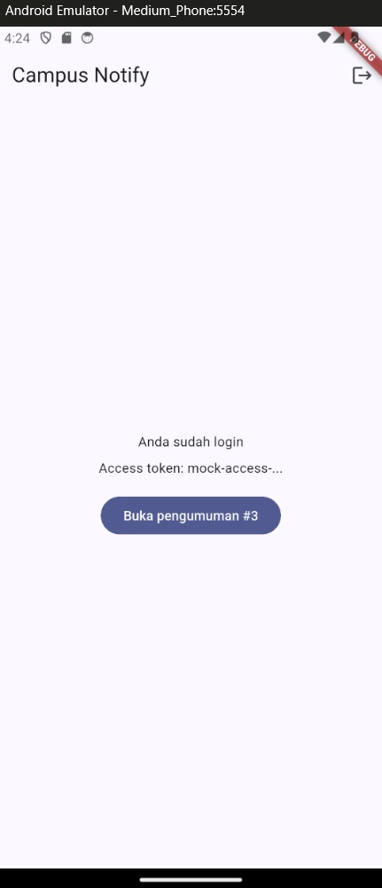
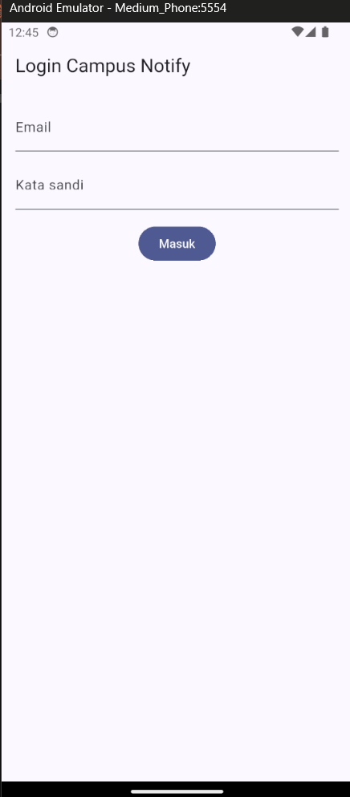
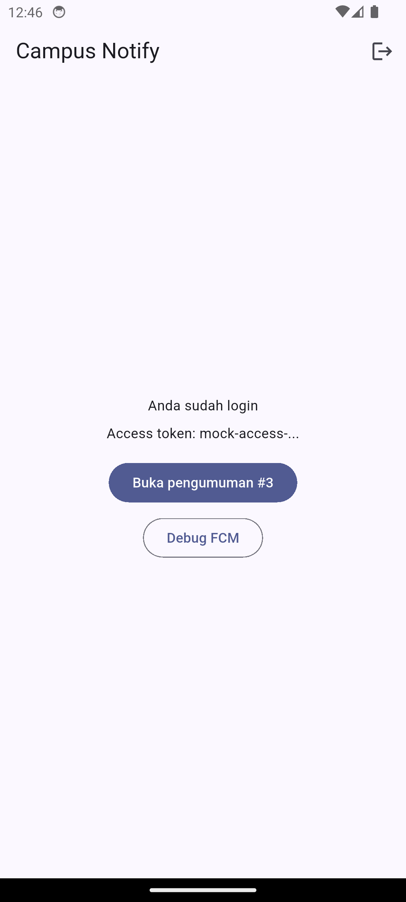

# Week 7 — Clean Architecture (`campus_notify`)

Refactor fitur **auth** pada aplikasi `campus_notify` (Week 6) ke **Clean Architecture**: memisahkan antarmuka (*interface*) dari implementasi, membagi kode ke dalam lapisan *presentation*, *domain*, dan *data*, serta menerapkan *Dependency Injection* (DI) terpusat berbasis Riverpod tanpa package tambahan. Proyek ini mencakup tiga praktikum (audit layer, domain & data, presentation & DI), pengujian regresi, evaluasi trade-off AI challenge, serta verifikasi aturan dependensi.

| Item | Keterangan |
|---|---|
| Arsitektur | Feature-First Clean Architecture (`domain`, `data`, `presentation`, `core`) |
| Fitur refactor | `auth` (login, logout, restore sesi, secure token storage) |
| State & DI | Riverpod (`Provider`, `AsyncNotifierProvider`, `FutureProvider`) |
| Error handling | Dart Record `({T? session, Failure? failure})` dan sealed class `Failure` |
| HTTP & Storage | Dio dengan refresh interceptor, `flutter_secure_storage` via `TokenStore` |
| Testing | 7 test lulus (6 unit test `AuthRepositoryImpl` + 1 smoke test), `flutter analyze` bersih |

---

## 1. Struktur proyek dan keputusan arsitektur

```
campus_notify/
└── lib/
    ├── core/
    │   └── failures.dart                              # sealed Failure, AuthFailure, NetworkFailure
    ├── data/
    │   └── api_client.dart                            # Dio + interceptor refresh token
    ├── features/
    │   └── auth/
    │       ├── domain/
    │       │   ├── entities/auth_session.dart         # entity murni Dart
    │       │   ├── repositories/auth_repository.dart  # abstract contract
    │       │   └── usecases/login.dart, logout.dart   # use case bisnis
    │       ├── data/
    │       │   ├── models/auth_session_model.dart     # fromMap/toMap/toEntity
    │       │   ├── repositories/auth_repository_impl.dart # implements AuthRepository
    │       │   └── token_store.dart                   # secure storage wrapper
    │       └── presentation/
    │           ├── pages/login_page.dart
    │           └── providers/auth_provider.dart       # DI provider & AuthNotifier
    ├── messaging/
    │   ├── background_handler.dart
    │   └── push_service.dart
    ├── pages/
    │   ├── announcement_page.dart
    │   ├── debug_page.dart
    │   └── home_page.dart
    └── main.dart
```

| Kebutuhan | Pilihan | Alasan |
|---|---|---|
| Pemisahan layer | Feature-First (`features/auth`) | Kode terisolasi per fitur; domain tidak terikat data atau UI |
| Kontrak repository | `abstract class AuthRepository` di domain | *Dependency Inversion*: presentation dan data bergantung ke abstraksi domain |
| Format error | Record `({T? session, Failure? failure})` | Fungsional bawaan Dart 3; exception teknis tidak bocor ke UI |
| Dependency Injection | Riverpod `Provider` murni | Terpusat, *compile-time safe*, dan mudah di-mock pada testing tanpa package tambahan |

Aturan dependensi yang diterapkan adalah **Presentation → Domain ← Data**. Lapisan domain murni Dart tanpa import Flutter, Dio, SQLite, maupun Firebase. UI tidak mengenal kelas konkret `AuthRepositoryImpl` dan hanya berkomunikasi melalui provider.

---

## 2. Praktikum 1 — Audit layer project lama

### Pemetaan file ke layer

| File | Layer saat ini | Masalah |
|---|---|---|
| `main.dart` | Bootstrap + presentation | Routing, guard auth, dan init push disatukan di satu file |
| `data/api_client.dart` | Data | Base URL hardcode; bergantung pada kelas konkret `TokenStore` dan `AuthRepository` |
| `data/auth_repository.dart` | Data (kontrak tercampur) | Interface dan implementasi satu kelas; `AuthSession` belum dipisah dari entity |
| `data/token_store.dart` | Data | Tanpa abstraksi; `FlutterSecureStorage()` dipanggil langsung |
| `messaging/push_service.dart` | Infrastruktur + presentation | Variabel global, navigasi UI langsung, `jsonDecode` tanpa model |
| `messaging/background_handler.dart` | Infrastruktur | Belum masuk struktur `core/` |
| `pages/home_page.dart` | Presentation | Baris 44: `tokenStoreProvider.readAccess()` dipanggil langsung di `build()` |
| `pages/login_page.dart` | Presentation | Baris 49: manipulasi teks `replaceFirst('Exception: ', '')` di `build()` |
| `pages/announcement_page.dart` | Presentation | Halaman statis, baru membaca ID dari route |
| `pages/debug_page.dart` | Presentation | Membaca variabel global `ValueNotifier` dari `push_service.dart` |
| `providers/auth_provider.dart` | Presentation (state) | Baris 11: instansiasi manual `AuthRepository()` di dalam file provider |

### Hasil tiga pencarian (sebelum refactor)

| Pencarian | Hasil |
|---|---|
| Widget menyentuh jaringan/database langsung (`lib/pages`) | 0 temuan |
| `DateFormat`/`jsonDecode`/`toIso8601String` di `lib/pages` | 0 temuan |
| Instansiasi manual `Repository(`/`Dio(BaseOptions` di `lib/pages`, `lib/providers` | 1 temuan (`lib/providers/auth_provider.dart:11`) |

Folder `lib/widgets` tidak ada pada proyek ini. Pelanggaran `home_page.dart:44` (widget membaca token store langsung) ditemukan melalui pembacaan manual karena tidak menggunakan kata kunci instansiasi kelas.

### Daftar item refactor

1. `auth_provider.dart:11`: repository dibuat manual → interface di domain, implementasi di data, disuntik lewat provider.
2. `home_page.dart:44`: widget membaca token store → membaca state `accessTokenProvider`.
3. `auth_repository.dart`: interface dan implementasi satu kelas → dipisah ke domain dan data.
4. `login_page.dart:49`: format error di `build()` → menerima pesan siap tampil dari `Failure`.
5. `api_client.dart`: bergantung kelas konkret → bergantung pada interface domain `AuthRepository`.
6. `push_service.dart`: variabel global dan navigasi langsung → dicatat sebagai utang teknis.

---

## 3. Praktikum 2 — Domain dan data

Lapisan domain dan data dibangun untuk memisahkan aturan bisnis dari implementasi teknis:

- `core/failures.dart`: hierarki error `sealed class Failure` (`AuthFailure`, `NetworkFailure`).
- `domain/entities/auth_session.dart`: class murni Dart, immutable, tanpa fungsi serialisasi.
- `domain/repositories/auth_repository.dart`: kontrak abstract class dengan kembalian Dart Record.
- `domain/usecases/`: use case `Login` dan `Logout` dengan operator `call()`.
- `data/models/auth_session_model.dart`: menangani `fromMap`, `toMap`, `fromJson`, `toJson`, dan `toEntity()`.
- `data/repositories/auth_repository_impl.dart`: implementasi `AuthRepository` dengan mock latency, validasi format, dan penanganan error ke `AuthFailure`.

### Bukti Praktikum 2







---

## 4. Praktikum 3 — Presentation, DI, dan verifikasi

### Wiring DI Riverpod (`auth_provider.dart`)

Dependency injection dikonsolidasikan terpusat di satu berkas provider:

```dart
final tokenStoreProvider = Provider<TokenStore>((ref) => TokenStore());

final authRepositoryProvider = Provider<AuthRepository>((ref) {
  return const AuthRepositoryImpl();
});

final loginUseCaseProvider = Provider<Login>((ref) {
  return Login(ref.watch(authRepositoryProvider));
});

final logoutUseCaseProvider = Provider<Logout>((ref) {
  return Logout(ref.watch(authRepositoryProvider));
});

final authStateProvider =
    AsyncNotifierProvider<AuthNotifier, bool>(AuthNotifier.new);

final accessTokenProvider = FutureProvider<String?>((ref) async {
  return ref.watch(tokenStoreProvider).readAccess();
});
```

`LoginPage` dipindahkan ke `features/auth/presentation/pages/`, `HomePage` membaca token lewat `accessTokenProvider`, dan file usang (`lib/data/auth_repository.dart`, `lib/providers/auth_provider.dart`) dihapus.



### Verifikasi dependency rule

| Pemeriksaan | Hasil |
|---|---|
| Presentation dan `lib/pages` bebas `Dio(`, `openDatabase`, `FlutterSecureStorage`, `jsonDecode` | 0 temuan |
| Domain dan core bebas import `flutter`, `dio`, `sqflite`, `firebase` | 0 temuan |
| `flutter analyze` | No issues found |
| `flutter test` | 7 test lulus |



### Uji manual emulator (sebelum vs sesudah)

Alur login valid, login gagal, Home token terpotong, dan logout diuji di emulator:

<table border="1" align="center" width="100%">
  <tr>
    <th align="center" width="50%">Sebelum (Week 6): Login gagal</th>
    <th align="center" width="50%">Sesudah (Week 7): Login gagal</th>
  </tr>
  <tr>
    <td align="center" valign="top"></td>
    <td align="center" valign="top"></td>
  </tr>
</table>

<table border="1" align="center" width="100%">
  <tr>
    <th align="center" width="50%">Sebelum (Week 6): Home & token</th>
    <th align="center" width="50%">Sesudah (Week 7): Home & token</th>
  </tr>
  <tr>
    <td align="center" valign="top"></td>
    <td align="center" valign="top"></td>
  </tr>
</table>

<table border="1" align="center" width="100%">
  <tr>
    <th align="center" width="50%">Halaman login setelah logout</th>
    <th align="center" width="50%">Login ulang berhasil</th>
  </tr>
  <tr>
    <td align="center" valign="top"></td>
    <td align="center" valign="top"></td>
  </tr>
</table>

Tampilan visual aplikasi tetap sama seperti Week 6; perbedaan mendasar terletak pada arah aliran kode: UI tidak lagi menginstansiasi repository sendiri atau memanipulasi exception, melainkan mengamati state provider.

---

## 5. Utang teknis (tidak dikerjakan)

| Utang Teknis | Letak | Alasan Tidak Dikerjakan |
|---|---|---|
| Variabel global (`fcmToken`, `appRouter`) dan navigasi langsung | `push_service.dart` | Fokus praktikum dibatasi pada refactoring fitur `auth` |
| Base URL `Dio` di-hardcode | `data/api_client.dart` | Belum dipindah ke konfigurasi provider di `core/network` |
| Routing menyatu di bootstrap | `main.dart` | Belum dipecah ke berkas modular `routes.dart` |
| Fitur tanpa lapisan data/domain | `pages/announcement_page.dart` | Belum memiliki alur backend nyata; menunda over-engineering |

---

## 6. AI Challenge

**Tool AI:** Claude / Gemini Coding Assistant

### Prompt yang digunakan

```
Project Flutter saya: campus_notify (auth + FCM + daftar pengumuman).
Kondisi kini: folder lib/{data, providers, pages, messaging},
repository tercampur dengan implementasi, widget memanggil Dio langsung.
Tugas:
1. Usulkan struktur feature-first Clean Architecture
   (presentation/domain/data) untuk fitur auth + announcements.
2. Untuk tiap file lama, sebutkan tujuan barunya (pindah/pecah/hapus).
3. Tandai bagian yang over-engineering bila diterapkan ke CRUD sederhana,
   dan kapan use case benar-benar dibutuhkan vs repository langsung.
4. Tunjukkan wiring DI dengan Riverpod (tanpa package DI tambahan).
Jelaskan trade-off setiap keputusan.
```

### Hasil verifikasi

| # | Pertanyaan verifikasi | Temuan |
|---|---|---|
| 1 | Interface repository di domain dan implementasi di data? | Ya. `AuthRepository` (abstract) di `domain/repositories/`, `AuthRepositoryImpl` di `data/repositories/` |
| 2 | Domain bebas import Flutter / Dio / SQLite / Firebase? | Ya. Diverifikasi via `git grep`: 0 import library luar di `domain` dan `core` |
| 3 | AI membuat use case untuk tiap CRUD satu-baris? | Ya pada draf awal AI (`GetAnnouncements`, `GetAnnouncementById`). Usulan ini ditolak karena over-engineering pada halaman yang belum memiliki alur data |
| 4 | Entity bebas mapping (`toMap`/`fromMap`/`toJson`)? | Ya. `AuthSession` murni Dart; seluruh serialisasi berada di `AuthSessionModel` |
| 5 | Wiring DI terpusat di provider tanpa instansiasi manual di widget? | Ya. Terpusat di `auth_provider.dart` (`Provider<AuthRepository>`); widget hanya mengonsumsi provider |
| 6 | Keputusan final | Hanya merefactor fitur `auth`. Fitur `announcements` dipertahankan di `pages/` agar tidak menambah kompleksitas tanpa manfaat fungsional |

### Kapan use case over-engineering vs dibutuhkan?

- **Over-engineering:** Membuat use case terpisah untuk operasi CRUD satu baris yang hanya meneruskan panggilan ke repository tanpa ada aturan bisnis atau transformasi data (contoh: `GetAnnouncementById` memanggil `repo.getById(id)`). Pada kasus ini, notifier cukup memanggil repository langsung lewat Riverpod.
- **Benar-benar dibutuhkan:** Use case wajib ada jika terdapat aturan bisnis nyata (validasi, rate-limiting), penggabungan multi-repository (orkestrasi transaksi), atau alur logika yang dipakai bersama oleh beberapa halaman UI berbeda.

### Hasil tiga grep verifikasi mandiri

```bash
# 1. Domain dan core bebas import luar
git grep -nE "(package:flutter|package:dio|package:sqflite|package:firebase)" -- "lib/features/auth/domain" "lib/core"
# Hasil: 0 temuan (bersih)

# 2. UI bebas instansiasi manual repository/storage/dio
git grep -nE "(AuthRepository|TokenStore|Dio)\(" -- "lib/features/auth/presentation/pages" "lib/pages"
# Hasil: 0 temuan (bersih)

# 3. Entity bebas fungsi serialisasi
git grep -nE "(toMap|fromMap|toJson|fromJson)" -- "lib/features/auth/domain/entities"
# Hasil: 0 temuan (bersih, mapping hanya ada di auth_session_model.dart)
```

Dokumentasi lengkap ada di folder `docs/`:
- [Prompt](docs/01-prompt.md)
- [Output awal AI](docs/02-output-awal-ai.md)
- [Hasil verifikasi](docs/03-hasil-verifikasi.md)
- [Hasil testing](docs/04-hasil-testing.md)

---

## 7. Testing

`test/auth_repository_test.dart` diperbarui untuk menguji `AuthRepositoryImpl` (6 test) dan `test/widget_test.dart` memverifikasi tampilan `LoginPage` saat cold-start tanpa token.

| # | Tes | Yang dibuktikan |
|---|---|---|
| 1 | `login` kredensial valid | Mengembalikan `AuthSession` dengan mock token |
| 2 | `login` email tanpa `@` | Mengembalikan `AuthFailure` |
| 3 | `login` sandi < 6 karakter | Mengembalikan `AuthFailure` |
| 4 | `refresh` token valid | Mengembalikan token baru |
| 5 | `refresh` token kosong | Mengembalikan `AuthFailure` |
| 6 | `logout` | Mengembalikan failure null |
| 7 | `widget_test.dart` (smoke test) | Form login tampil saat awal dibuka tanpa token |

```
flutter analyze
No issues found!

flutter test
00:03 +7: All tests passed!
```

---

## 8. Checklist verifikasi mandiri

- [x] Interface repository di domain, implementasi di data
- [x] Domain dan core bebas import Flutter, Dio, SQLite, dan Firebase
- [x] Entity bebas mapping (`toMap`/`fromMap`/`toJson` hanya di model data)
- [x] Wiring DI terpusat di provider Riverpod; widget tidak instansiasi repository sendiri
- [x] Use case satu baris tanpa aturan bisnis dihindari pada fitur CRUD sederhana
- [x] Hasil repository berbentuk record Dart dengan `Failure` tanpa kebocoran exception ke UI
- [x] `flutter analyze` tanpa issue dan 7 test lulus pada `flutter test`
- [x] Hasil AI diverifikasi dan didokumentasikan pada folder `docs/`