# Minggu 8: Mid Project Review & Code Review

**Nama:** Angel Chelsea
**NIM:** 244107020202
**Repository:** `244107020202-mobile-course`

## Daftar Isi
- [Praktikum 1: Hygiene Branch dan Commit](#praktikum-1-hygiene-branch-dan-commit)
- [Praktikum 2: PR dan Peer Review](#praktikum-2-pr-dan-peer-review)
- [Praktikum 3: Static Analysis dan Mid Review](#praktikum-3-static-analysis-dan-mid-review)

---

## Praktikum 1: Hygiene Branch dan Commit

### 1. Audit riwayat

Perintah yang dijalankan di root repository:

```
git --no-pager log --oneline -15
git branch -a
git status
```

<table border="1" cellpadding="8" cellspacing="0" align="center">
  <tr>
    <th align="center">Audit riwayat, branch, dan status</th>
  </tr>
  <tr>
    <td align="center"></td>
  </tr>
</table>

**Temuan:**

| Commit | Masalah |
|--------|---------|
| `4cbf1bd`, `a2f69dc` `docs: praktikum 2 screenshots` | Pesan identik dan tanpa scope |
| `ce97c47`, `a06a629` `feat(week6): implement ... with complete report` | Pesan kembar; satu commit memuat auth, security, FCM, dan laporan |
| `1512491` `feat(week5): catatan offline dengan SQLite, ...` | Terlalu banyak hal dalam satu commit; bahasa campur |
| `0ab281a` `refactor: establish week 7 ... restore week 6 baseline` | Tanpa scope; dua tujuan dalam satu commit |

**Branch:** branch `develop` belum ada, dan terdapat branch cadangan lokal `backup-before-repair-week6-week7`. **Working tree** bersih (tidak ada file tak terlacak).

### 2. Branch kerja yang benar

`develop` dibuat dari `main` satu kali dan di-push, lalu `feat/notes-validation` dibuat dari `develop`.

```
git checkout main
git checkout -b develop
git push -u origin develop
git checkout -b feat/notes-validation
```

Perubahan kecil yang dikerjakan: **validasi judul kosong** pada dialog "Catatan baru".

- `lib/utils/validators.dart`: fungsi `validateTitle`
- `lib/pages/notes_page.dart`: dialog memvalidasi judul dan menampilkan `errorText`
- `test/validators_test.dart`: test judul kosong, spasi, `null`, dan judul valid

Commit dibuat dengan `git add -p` agar hanya memuat perubahan yang terkait:

```
git commit -m "feat(notes): validasi judul kosong + test"
```

#### Hasil validasi judul

<table border="1" cellpadding="8" cellspacing="0" align="center">
  <tr>
    <th align="center" width="33%">Judul kosong ditolak</th>
    <th align="center" width="33%">Input judul valid</th>
    <th align="center" width="33%">Catatan tersimpan</th>
  </tr>
  <tr>
    <td align="center"></td>
    <td align="center"></td>
    <td align="center"></td>
  </tr>
  <tr>
    <td align="center">Dialog tetap terbuka dengan pesan "Judul tidak boleh kosong"</td>
    <td align="center">Judul dan isi terisi</td>
    <td align="center">Catatan masuk daftar (belum sinkron)</td>
  </tr>
</table>

#### Hasil test

`flutter test` dijalankan dari `week5_offline_notes`:

<table border="1" cellpadding="8" cellspacing="0" align="center">
  <tr>
    <th align="center">Test lolos (+9: All tests passed!)</th>
  </tr>
  <tr>
    <td align="center"></td>
  </tr>
</table>

### 3. Perbaikan commit buruk (simulasi)

Tabel lengkap ada di [docs/review-checklist.md](docs/review-checklist.md).

| Sebelum | Sesudah |
|---------|---------|
| `docs: praktikum 2 screenshots` | `docs(week7): tambah screenshot hasil praktikum 2 clean architecture` |
| `feat(week6): implement campus_notify authentication, ...` | `feat(auth): implementasi login dan penyimpanan token aman` (dipecah) |
| `refactor: establish week 7 ... restore week 6 baseline` | `refactor(week7): salin campus_notify ...` dan `chore(week6): pulihkan baseline` |

### Catatan pengelolaan folder

Latihan awalnya dikerjakan di `05-week-5-local-storage-offline-first`, lalu dipindahkan ke folder ini agar jobsheet 5 tetap utuh. Karena commit sudah di-push, riwayat tidak ditulis ulang (tanpa `reset` atau `force push`); pemindahan dilakukan dengan `git revert` dan `git mv`. Hasilnya `git diff --stat main -- 05-week-5-local-storage-offline-first` kosong.

| Commit | Keterangan |
|--------|-----------|
| `07f40cb` | `feat(notes): validasi judul kosong + test` |
| `bf03a0f` | Revert di folder 05 |
| `d6613f8` | Salin latihan ke folder minggu 8 |
| `c3b7a12` | `docs(week8): tambah checklist review dan tabel perbaikan commit` |
| `0b80c3b` | Pindah ke `08-week-8-mid-project-review` |

---

## Praktikum 2: PR dan Peer Review

**Pull Request:** https://github.com/ArifahZhafirah/244107020188-mobile-course/pull/1

### 1. Tukar PR dengan pasangan

<table border="1" cellpadding="8" cellspacing="0" align="center">
  <tr>
    <th align="center">Tukar PR dengan pasangan</th>
  </tr>
  <tr>
    <td align="center">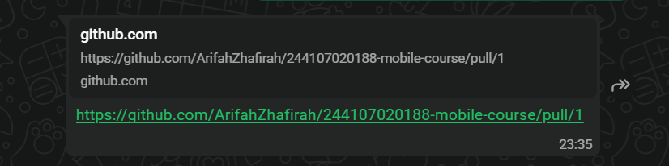</td>
  </tr>
</table>

### 2. Review yang saya berikan

<table border="1" cellpadding="8" cellspacing="0" align="center">
  <tr>
    <th align="center">PR pasangan yang saya review</th>
  </tr>
  <tr>
    <td align="center">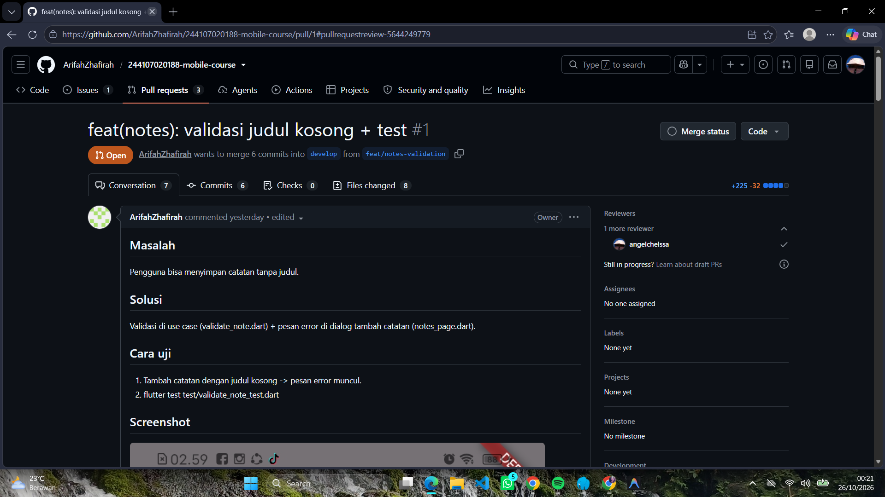</td>
  </tr>
</table>

<table border="1" cellpadding="8" cellspacing="0" align="center">
  <tr>
    <th align="center">Keputusan review (Approve) dan tabel temuan</th>
  </tr>
  <tr>
    <td align="center">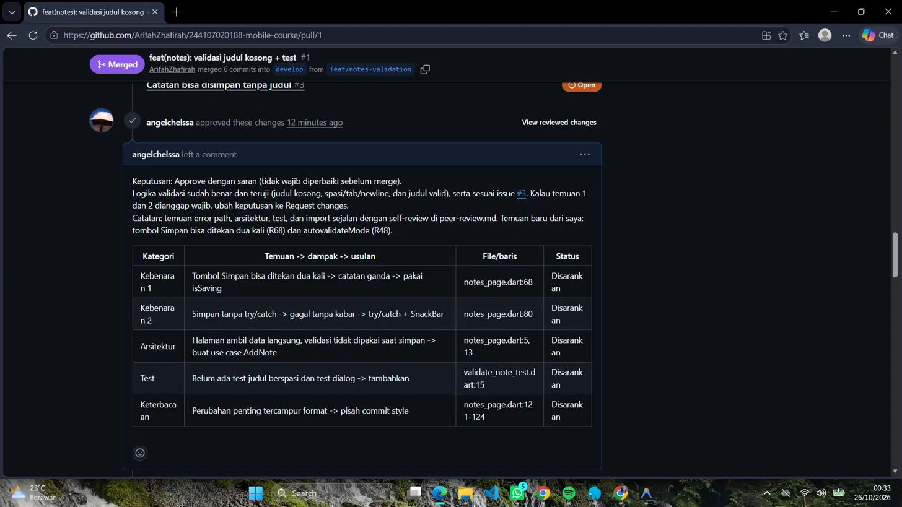</td>
  </tr>
</table>

#### Komentar inline

<table border="1" cellpadding="8" cellspacing="0" align="center" width="750">
  <tr>
    <th align="center" width="50%">Komentar 1</th>
    <th align="center" width="50%">Komentar 2</th>
  </tr>
  <tr>
    <td align="center">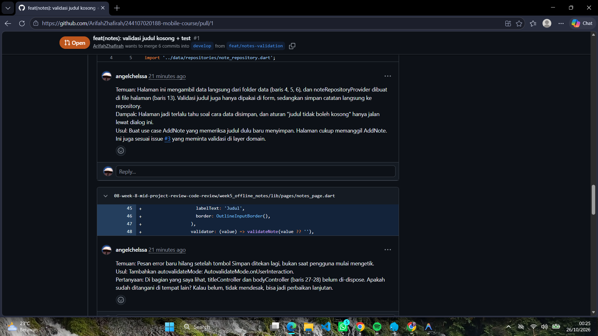</td>
    <td align="center">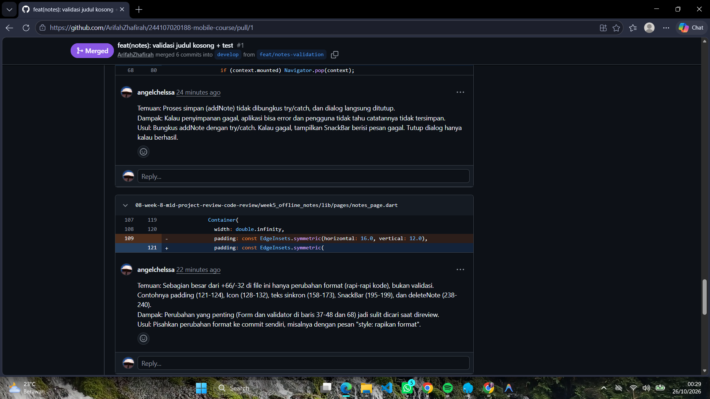</td>
  </tr>
</table>

<table border="1" cellpadding="8" cellspacing="0" align="center" width="750">
  <tr>
    <th align="center" width="50%">Komentar 3</th>
    <th align="center" width="50%">Komentar 4</th>
  </tr>
  <tr>
    <td align="center">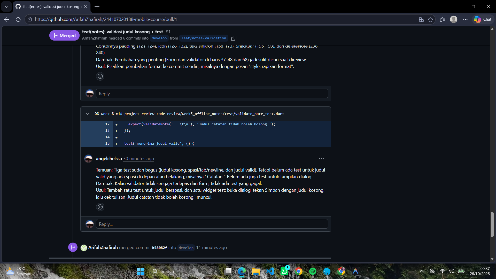</td>
    <td align="center">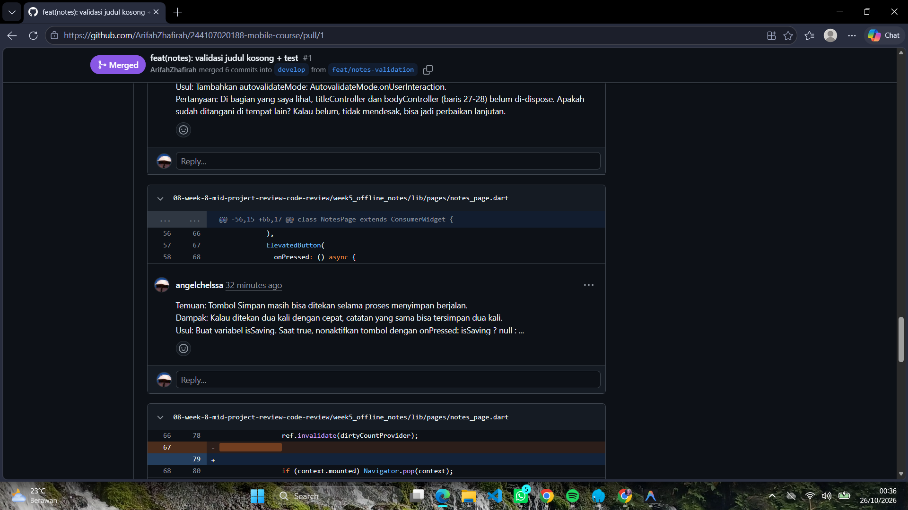</td>
  </tr>
</table>

### 3. PR pasangan setelah merge

<table border="1" cellpadding="8" cellspacing="0" align="center">
  <tr>
    <th align="center">PR pasangan berstatus merged</th>
  </tr>
  <tr>
    <td align="center"></td>
  </tr>
</table>

---

## Praktikum 3: Validasi Judul Catatan

### 1. Tujuan

Menambah validasi judul pada dialog "Catatan baru" berdasarkan hasil peer review.
Tiga kondisi yang dicegah:

- Judul kosong atau hanya spasi.
- Judul lebih dari 200 karakter.
- Judul duplikat yang sudah tersimpan.

### 2. Perubahan Kode

| File | Penjelasan |
|------|------------|
| `lib/utils/validators.dart` | Fungsi `validateTitle` diperluas dengan aturan panjang maksimum 200 karakter. Fungsi baru `validateTitleDuplicate` memeriksa duplikat secara case-insensitive setelah spasi di tepi dibuang. |
| `lib/pages/notes_page.dart` | Dialog "Catatan baru" menerima daftar judul yang sudah ada dan menjalankan kedua validasi sebelum menyimpan catatan. |
| `test/validators_test.dart` | Tiga grup pengujian ditambahkan: judul hanya spasi ditolak, batas 200 karakter (200 diterima, 201 ditolak), dan duplikat case-insensitive ditolak. |

### 3. Aturan Validasi

| No | Kondisi | Pesan yang muncul |
|----|---------|-------------------|
| 1 | Judul kosong atau hanya spasi | `Judul tidak boleh kosong` |
| 2 | Judul lebih dari 200 karakter | `Judul terlalu panjang (maks. 200 karakter)` |
| 3 | Judul sudah ada di daftar | `Judul catatan sudah ada` |

**Catatan:** Pengecekan duplikat tidak membedakan huruf besar/kecil dan mengabaikan spasi di tepi. Batas 200 karakter adalah tambahan di luar permintaan awal.

### 4. Hasil Pengujian Aplikasi

<table border="1" cellpadding="8" cellspacing="0" align="center" width="750">
  <tr>
    <th align="center" width="33%">Judul kosong ditolak</th>
    <th align="center" width="33%">Judul hanya spasi ditolak</th>
    <th align="center" width="33%">Judul duplikat ditolak</th>
  </tr>
  <tr>
    <td align="center">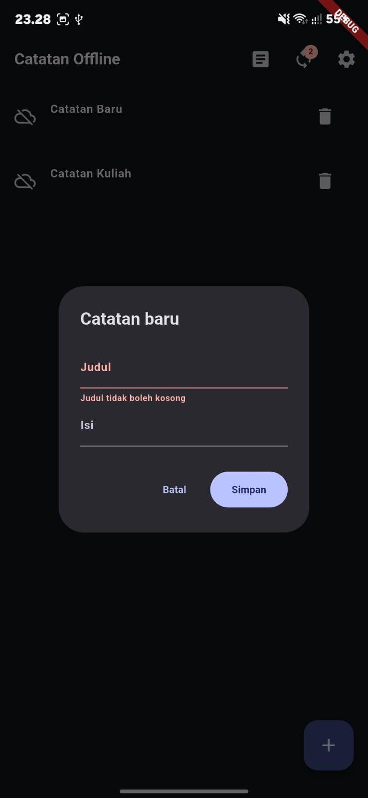</td>
    <td align="center">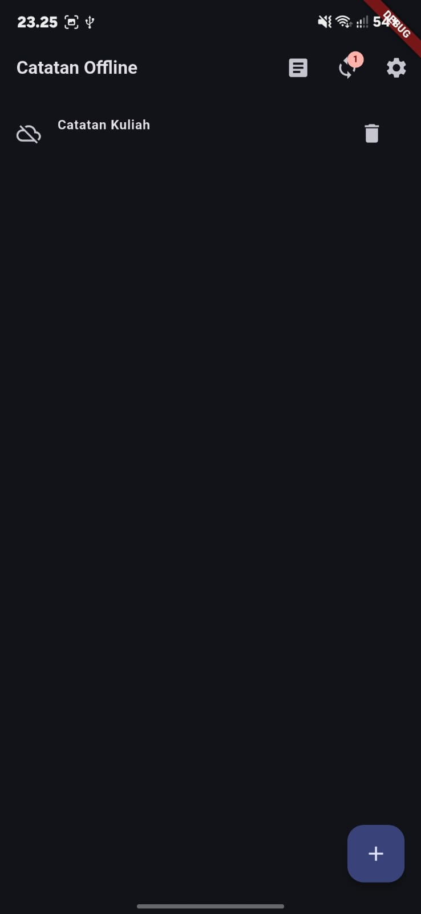</td>
    <td align="center">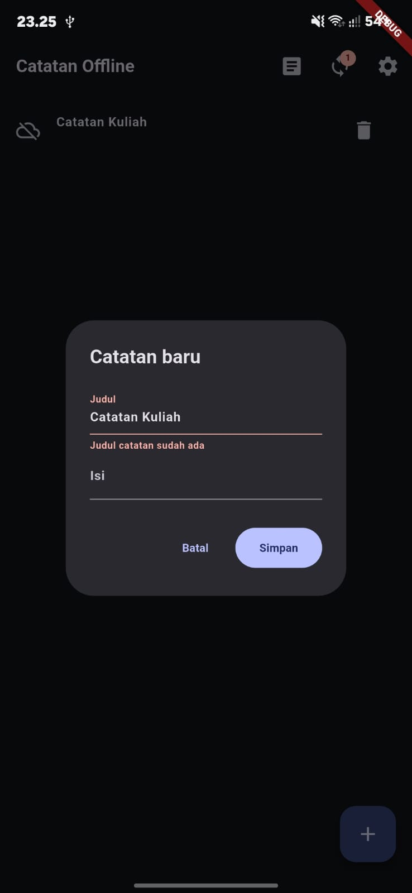</td>
  </tr>
  <tr>
    <td align="center">Dialog tetap terbuka, pesan "Judul tidak boleh kosong"</td>
    <td align="center">Spasi saja dianggap kosong (trim)</td>
    <td align="center">Judul yang sama persis ditolak</td>
  </tr>
</table>

<table border="1" cellpadding="8" cellspacing="0" align="center" width="750">
  <tr>
    <th align="center" width="33%">Duplikat beda huruf ditolak</th>
    <th align="center" width="33%">Judul 201 karakter ditolak</th>
    <th align="center" width="33%">Judul valid berhasil disimpan</th>
  </tr>
  <tr>
    <td align="center">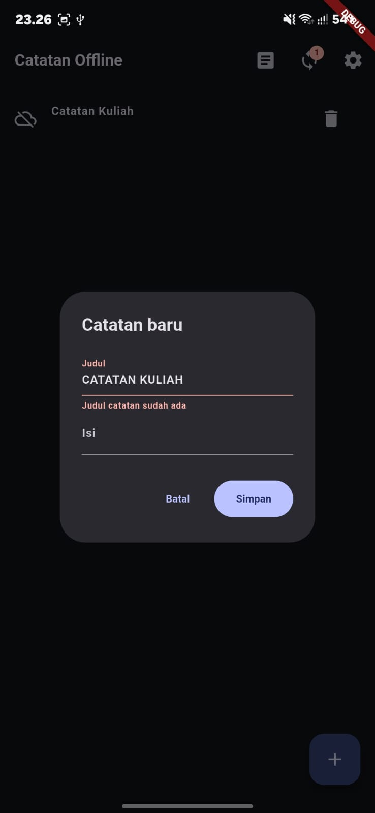</td>
    <td align="center">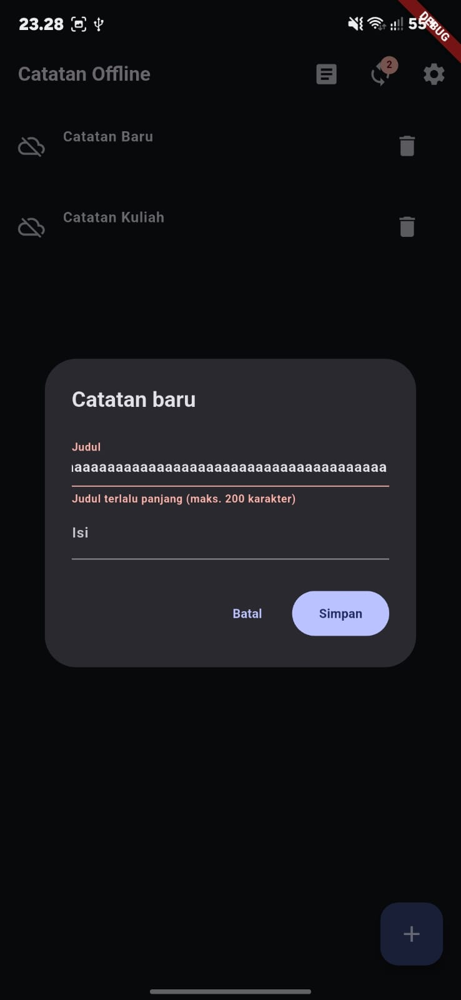</td>
    <td align="center">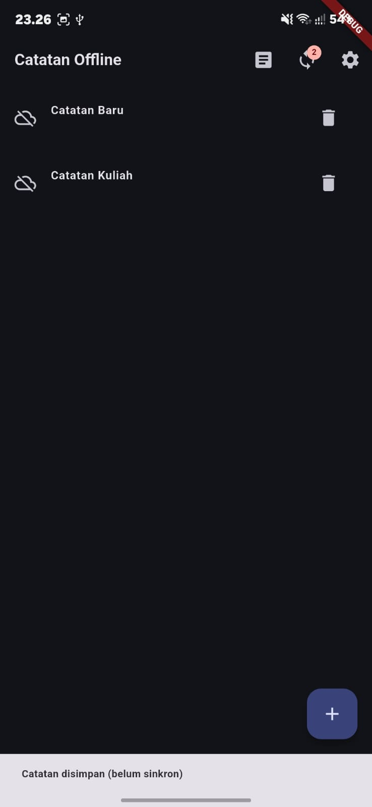</td>
  </tr>
  <tr>
    <td align="center">"catatan" dan "Catatan" dianggap duplikat</td>
    <td align="center">Pesan "Judul terlalu panjang (maks. 200 karakter)"</td>
    <td align="center">Catatan masuk daftar (belum sinkron)</td>
  </tr>
</table>

### 5. Hasil Pemeriksaan Kode

Dijalankan dari folder `08-week-8-mid-project-review/week5_offline_notes`:

| Perintah | Fungsi | Hasil |
|----------|--------|-------|
| `flutter analyze` | Analisis statis kode | No issues found! |
| `dart format --set-exit-if-changed lib test` | Periksa format kode | Formatted 15 files (0 changed) |
| `flutter test` | Jalankan semua unit test | +12: All tests passed! |

<table border="1" cellpadding="8" cellspacing="0" align="center" width="750">
  <tr>
    <th align="center">Hasil flutter analyze</th>
  </tr>
  <tr>
    <td align="center">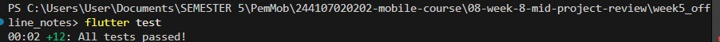</td>
  </tr>
</table>

<table border="1" cellpadding="8" cellspacing="0" align="center" width="750">
  <tr>
    <th align="center">Hasil dart format --set-exit-if-changed lib test</th>
  </tr>
  <tr>
    <td align="center">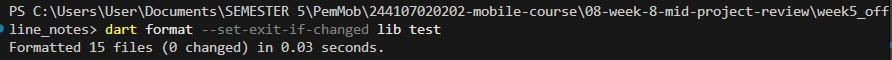</td>
  </tr>
</table>

<table border="1" cellpadding="8" cellspacing="0" align="center" width="750">
  <tr>
    <th align="center">Hasil flutter test</th>
  </tr>
  <tr>
    <td align="center">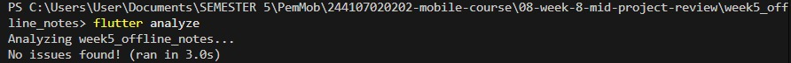</td>
  </tr>
</table>

### 6. Catatan dan Keterbatasan

- Pengecekan duplikat memakai daftar judul saat dialog dibuka; jika data masih loading atau error, daftar kosong sehingga pengecekan dilewati.
- `flutter analyze` dari root repo menemukan 1 error lama di `02-week-2.../test/widget_test.dart` (`MyApp` tidak ada); di luar cakupan project Minggu 8.

