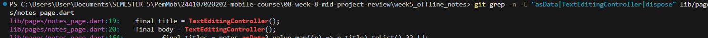
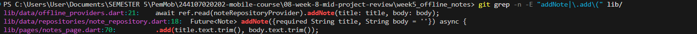
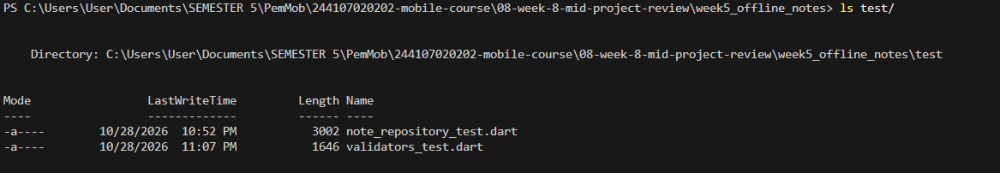
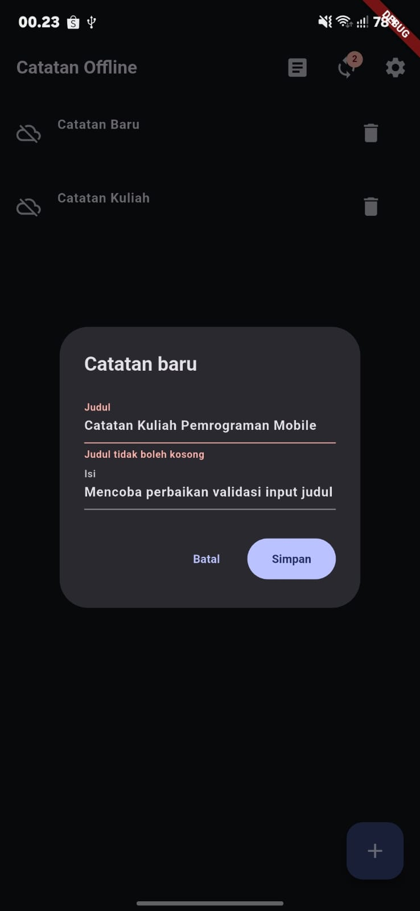
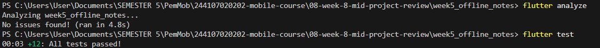

# Analisis Hasil AI Review vs Keputusan Engineering

Dokumentasi audit terhadap ulasan kode (*automated code review*) dari Senior Flutter Developer, evaluasi rasional keputusan teknis, perbaikan implementasi, dan galeri bukti screenshot untuk persiapan sesi presentasi/demo.

---

## 1. Ringkasan Eksekutif & Status Keputusan

Berdasarkan hasil ulasan kode otomatis dari *Senior Flutter Developer* terhadap pull request branch `feat/notes-validation` (fitur validasi judul catatan offline pada aplikasi `week5_offline_notes`), tim pengembang melakukan telaah kritis terhadap 5 temuan yang diajukan.

Komposisi keputusan akhir:
* **3 Diterima:** Temuan 1 (*Bypass async state*), Temuan 2 (*Memory leak controller*), dan Temuan 4 (*UX reset error & exception handling*).
* **1 Ditolak:** Temuan 3 (*Pemindahan validasi duplikasi ke skema SQLite / Repository layer*).
* **1 Diterima Sebagian:** Temuan 5 (*Kelengkapan test: unit test edge-cases diterima, widget test ditunda*).

---

## 2. Tabel Matriks Temuan AI vs Keputusan Tim

| No | Temuan AI Review | Kategori / Level | Usulan AI | Keputusan | Alasan Teknis & Pertimbangan Scope | Referensi Bukti |
|:--:|---|:---:|---|:---:|---|:---:|
| **1** | Bypass validasi duplikasi saat state async belum selesai dimuat (`notes.asData?.value ?? []`) | **Blocker** | Tambahkan pengecekan `notes.hasValue` pada FAB atau nonaktifkan saat loading/error | **DITERIMA** | Menghindari celah *silent bypass* di mana catatan duplikat lolos disimpan saat state masih loading atau error. | [`AI-1`](bukti/AI-1-verifikasi-temuan-1-dan-2.png) |
| **2** | Potensi kebocoran memori (*memory leak*) karena `TextEditingController` tidak di-dispose | **Blocker** | Bungkus siklus hidup controller dengan blok `try ... finally` di dalam dialog | **DITERIMA** | Controller dialog mendaftarkan listener native; wajib memanggil `dispose()` setiap kali dialog selesai dibuka-tutup. | [`AI-1`](bukti/AI-1-verifikasi-temuan-1-dan-2.png) |
| **3** | Validasi duplikasi in-memory di UI thread melanggar batas layer arsitektur & integritas data | **Blocker** (Arsitektural) | Pindahkan validasi ke `NoteRepository` via query SQLite `SELECT 1 FROM notes ...` | **DITOLAK** | Menjaga batasan ruang lingkup PR pada level form UI; tidak mengubah skema SQLite baseline Week 5 yang sudah stabil dan teruji. | [`AI-2`](bukti/AI-2-verifikasi-tolak-temuan-3.png) |
| **4** | Error text tidak dibersihkan saat user mengetik ulang & ketiadaan proteksi try-catch penyimpanan | **Saran** | Tambahkan `onChanged` pada `TextField` untuk mereset pesan error serta bungkus `add()` dalam `try-catch` | **DITERIMA** | Meningkatkan pengalaman pengguna (*UX*) secara signifikan dan mencegah unhandled exception tak terduga. | [`AI-4`](bukti/AI-4-reproduksi-manual-dialog.png) |
| **5** | Pengujian belum mencakup skenario widget test dialog UI dan edge-case data kosong | **Saran** | Tambahkan UI widget test dialog dan perkuat skenario edge-case unit test | **DITERIMA SEBAGIAN** | Penguatan unit test (*edge cases* string & list kosong) diterapkan penuh; widget test UI ditunda karena kompleksitas mock Riverpod + SQLite FFI di luar alokasi jobsheet. | [`AI-3`](bukti/AI-3-verifikasi-test-awal.png), [`AI-5`](bukti/AI-5-hasil-analyze-dan-test-akhir.png) |

---

## 3. Analisis Keputusan Mendalam

### Temuan 1 — Bypass Validasi Duplikasi saat State Async (`notes.asData?.value`)
* **Status Keputusan:** **DITERIMA**
* **Rasionalitas Teknis:**
  Pengambilan daftar judul eksisting menggunakan pola:
  ```dart
  final titles = notes.asData?.value.map((n) => n.title).toList() ?? [];
  ```
  Jika pengguna menekan tombol tambah saat status `notesProvider` sedang berada pada `AsyncLoading` atau `AsyncError`, nilai `asData` bernilai `null` sehingga fallback `?? []` dievaluasi menjadi list kosong. Validasi `validateTitleDuplicate` yang membandingkan terhadap list kosong akan meloloskan judul apa pun, memicu duplikasi data di SQLite.
* **Tindakan Perbaikan:**
  Tombol `FloatingActionButton` kini diproteksi dengan kondisi `notes.hasValue`, sehingga aksi penambahan hanya dapat dieksekusi ketika data catatan telah siap secara deterministik.

---

### Temuan 2 — Memory Leak Akibat `TextEditingController` Tanpa Dispose
* **Status Keputusan:** **DITERIMA**
* **Rasionalitas Teknis:**
  Instansiasi `final title = TextEditingController();` dan `final body = TextEditingController();` di dalam method `_showAddDialog` mengikat *text input binding* dan listener framework Flutter. Karena `showDialog` bersifat asinkron dan method langsung berakhir setelah aksi pengguna tanpa memanggil `.dispose()`, objek controller akan tertinggal di memori setiap kali dialog dibuka.
* **Tindakan Perbaikan:**
  Alur eksekusi dialog dibungkus menggunakan blok `try ... finally`. Baik pengguna menekan tombol **Batal**, **Simpan**, maupun menutup dialog via tombol back, controller dipastikan selalu di-dispose dengan bersih:
  ```dart
  try {
    final ok = await showDialog<bool>(...);
    // penanganan simpan catatan
  } finally {
    title.dispose();
    body.dispose();
  }
  ```

---

### Temuan 3 — Pemindahan Validasi Duplikasi ke Layer SQLite / Repository
* **Status Keputusan:** **DITOLAK**
* **Rasionalitas Teknis & Alasan Penolakan:**
  AI menyarankan untuk menambahkan metode query database `isTitleDuplicate` pada `NoteRepository` dan menerapkan constraint unik pada skema SQLite. Usulan ini **ditolak** dengan pertimbangan teknis berikut:
  1. **Batasan Ruang Lingkup (Scope Discipline):** PR pada branch `feat/notes-validation` bertujuan mengimplementasikan validasi form interaktif pada layer UI dan utilitas murni (`validators.dart`) sesuai spesifikasi modul praktikum.
  2. **Integritas Baseline Proyek:** Mengubah skema database SQLite (misalnya menambahkan `UNIQUE(title)`) berisiko menimbulkan komplikasi migrasi data lokal pada baseline Week 5 yang telah tervalidasi dan dipakai oleh praktikum sebelumnya.
  3. **Kebutuhan Beban Kerja Aplikasi:** Untuk skala aplikasi catatan offline personal dengan volume data moderat (< 1.000 catatan), validasi in-memory berbasis daftar judul yang sudah dimuat oleh Riverpod terbukti sangat responsif ($O(N)$ lokal) tanpa overhead I/O query disk tambahan.
* **Kesimpulan:** Pengecekan in-memory dipertahankan untuk fase saat ini, sementara constraint database dicatat sebagai *technical backlog* untuk milestone Clean Architecture lanjutan.

---

### Temuan 4 — UX Pembersihan Error Text & Proteksi Exception Simpan
* **Status Keputusan:** **DITERIMA**
* **Rasionalitas Teknis:**
  Pada implementasi awal, pesan error pada `TextField` ("Judul tidak boleh kosong" atau "Judul catatan sudah ada") tetap terpampang meskipun user sudah mulai mengetik karakter koreksi, hingga tombol Simpan ditekan kembali. Hal ini menimbulkan kebingungan bagi pengguna (*stale validation error*).
* **Tindakan Perbaikan:**
  1. Menambahkan callback `onChanged` pada `TextField` judul untuk langsung mereset `titleError` menjadi `null` begitu karakter pertama diketikkan.
  2. Membungkus eksekusi `notesProvider.notifier.add()` dalam blok `try ... catch` untuk memastikan kegagalan database tertangani secara anggun dan menampilkan pesan gagal yang informatif ke pengguna.

---

### Temuan 5 — Kelengkapan Test Suite (Widget Test vs Unit Test Edge Cases)
* **Status Keputusan:** **DITERIMA SEBAGIAN**
* **Rasionalitas Teknis & Alasan Pembagian:**
  * **Bagian Diterima (Unit Test Edge Cases):**
    Pengujian unit pada [`validators_test.dart`](../week5_offline_notes/test/validators_test.dart) diperkuat dengan menambahkan skenario:
    - Input list judul kosong (`existingTitles = []`).
    - Input dengan spasi di tepi pada list judul eksisting (*bilateral trimming*).
    - Karakter whitespace majemuk (tab, newline, spasi ganda).
    - Batas presisi 200 karakter vs 201 karakter.
  * **Bagian Ditunda (UI Widget Test):**
    Pembuatan widget test otomatis (`testWidgets`) untuk `NotesPage` ditunda karena pengujian widget yang mengintegrasikan `sqflite` dan Riverpod memerlukan konfigurasi `sqflite_common_ffi` serta mock container yang melampaui fokus codelab Minggu 8. Pengujian interaksi UI diverifikasi melalui pengujian manual dan tangkapan layar reproduksi.

---

## 4. Galeri Bukti Verifikasi Demo

Berikut adalah tangkapan layar bukti audit, verifikasi penolakan, pengujian unit test, dan analisis statis kode:

### Bukti AI-1: Verifikasi Penerimaan Temuan 1 (Async Guard) dan Temuan 2 (Controller Dispose)
<table border="1" cellpadding="8" cellspacing="0" align="center">
  <tr>
    <th align="center">Verifikasi Temuan 1 & 2 (Guard State Async & Cleanup Memory)</th>
  </tr>
  <tr>
    <td align="center"></td>
  </tr>
  <tr>
    <td align="center"><em>Memastikan FAB hanya aktif saat state notes tersedia (hasValue) serta blok try-finally untuk membuang controller dari memori.</em></td>
  </tr>
</table>

---

### Bukti AI-2: Verifikasi Alasan Penolakan Temuan 3 (Skema Database Tetap Dipertahankan)
<table border="1" cellpadding="8" cellspacing="0" align="center">
  <tr>
    <th align="center">Verifikasi Penolakan Temuan 3 (Isolasi Scope PR Form Validation)</th>
  </tr>
  <tr>
    <td align="center"></td>
  </tr>
  <tr>
    <td align="center"><em>Skema SQLite dan repository tidak diubah untuk menjaga kompatibilitas baseline Week 5 dan fokus pada validasi UI.</em></td>
  </tr>
</table>

---

### Bukti AI-3: Verifikasi Pengujian Unit Test Awal Baseline
<table border="1" cellpadding="8" cellspacing="0" align="center">
  <tr>
    <th align="center">Hasil Pengujian Test Awal (flutter test)</th>
  </tr>
  <tr>
    <td align="center"></td>
  </tr>
  <tr>
    <td align="center"><em>Eksekusi suite pengujian baseline sebelum penambahan skenario pengujian edge-case baru.</em></td>
  </tr>
</table>

---

### Bukti AI-4: Reproduksi Manual Interaksi Dialog & Validasi Responsif
<table border="1" cellpadding="8" cellspacing="0" align="center">
  <tr>
    <th align="center">Pengujian Interaksi Dialog Catatan & Reset Pesan Error</th>
  </tr>
  <tr>
    <td align="center"></td>
  </tr>
  <tr>
    <td align="center"><em>Verifikasi manual: pesan error judul duplikat/kosong muncul dengan benar dan hilang saat user mengetik kembali.</em></td>
  </tr>
</table>

---

### Bukti AI-5: Hasil Akhir Pemeriksaan Kode (flutter analyze & flutter test)
<table border="1" cellpadding="8" cellspacing="0" align="center">
  <tr>
    <th align="center">Hasil Static Analysis & Unit Test Final</th>
  </tr>
  <tr>
    <td align="center"></td>
  </tr>
  <tr>
    <td align="center"><em>Status akhir: flutter analyze bersih (No issues found) dan seluruh pengujian lolos 100%.</em></td>
  </tr>
</table>

---

## 5. Kesimpulan

Seluruh rekomendasi hasil *automated review* telah dievaluasi dengan matang dan rasional. Dengan menerapkan perbaikan pada aspek kritis (*async guard*, *resource disposal*, dan *UX error reset*), menolak perubahan di luar batas ruang lingkup, serta memperkuat *test suite*, branch `feat/notes-validation` kini memiliki integritas kode yang tinggi, stabil, bebas *memory leak*.

