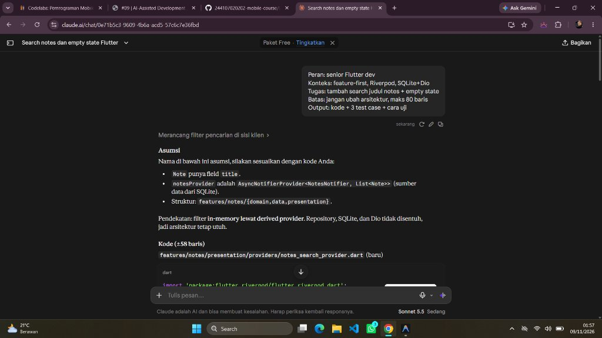
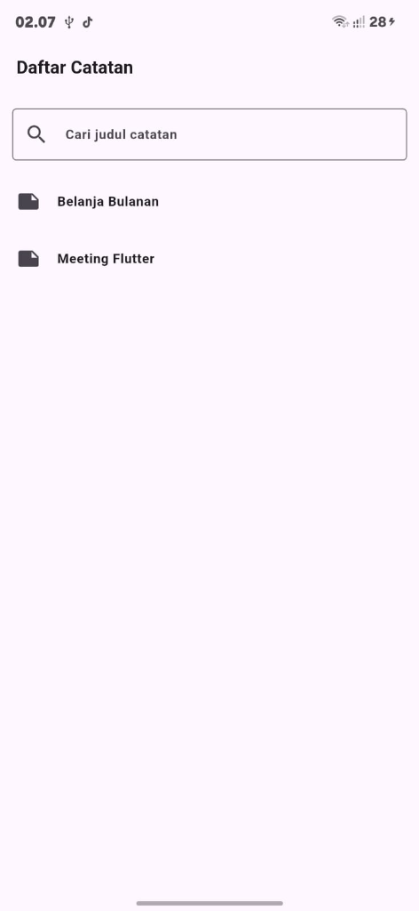
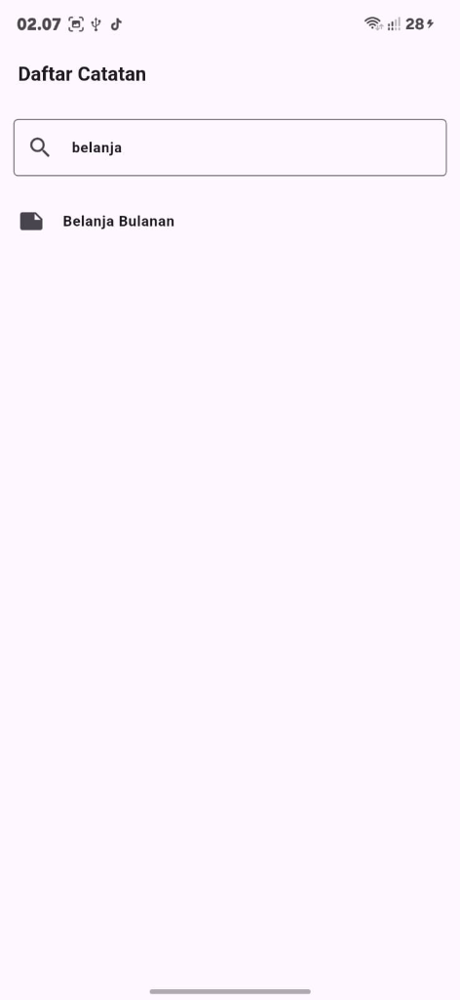
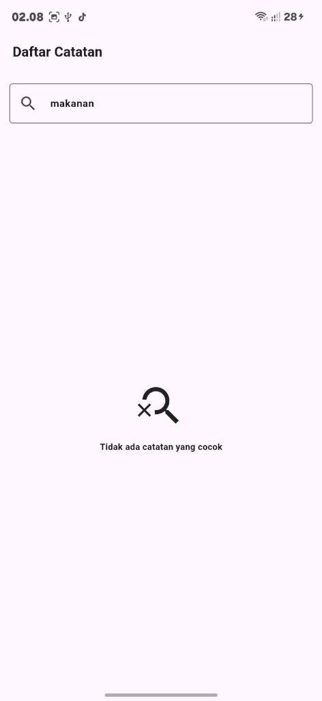
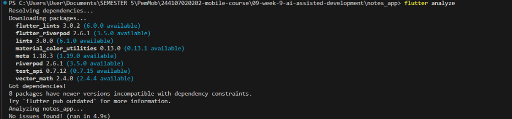
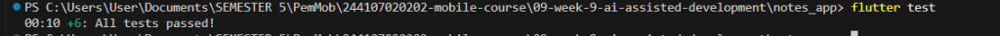

# Laporan Praktikum Week 09: AI-Assisted Development

**Nama:** Angel Chelsea  
**NIM:** 244107020202  
**Repository:** `244107020202-mobile-course`  
**Mata Kuliah:** Pemrograman Mobile  
**Topik Utama:** AI-Assisted Development, Context Engineering, Prompt Debugging, dan Refactoring  
**Referensi Codelab:** [09-minggu-9-ai-assisted-development-vibe-coding](https://jti-polinema.github.io/flutter-codelab/09-minggu-9-ai-assisted-development-vibe-coding/index.html#)

---

## 📑 Daftar Isi
1. [Ringkasan Eksekutif & Dokumentasi Screenshot](#1-ringkasan-eksekutif--dokumentasi-screenshot)
2. [Praktikum 1: Prompt dan Context Engineering](#2-praktikum-1-prompt-dan-context-engineering)
   - [Formula 5 Slot & Hasil Respon Claude AI](#21-formula-5-slot--hasil-respon-claude-ai)
   - [Analisis Perbandingan Prompt Buruk vs Prompt Baik](#22-analisis-perbandingan-prompt-buruk-vs-prompt-baik)
   - [Context Hygiene: Sanitasi Secret & Token Placeholder](#23-context-hygiene-sanitasi-secret--token-placeholder)
3. [Praktikum 2: Generate dan Verifikasi Search](#3-praktikum-2-generate-dan-verifikasi-search)
   - [Fitur Search dengan Debounce Timer](#31-fitur-search-dengan-debounce-timer)
   - [Verifikasi 6 Langkah Lengkap](#32-verifikasi-6-langkah-lengkap)
   - [Bukti Pengujian Tampilan UI (3 Kondisi)](#33-bukti-pengujian-tampilan-ui-3-kondisi)
4. [Praktikum 3: Refactoring Challenge, Testing, dan Error Umum](#4-praktikum-3-refactoring-challenge-testing-dan-error-umum)
   - [Refactoring Challenge: Pemindahan Filter ke Domain Use Case Murni](#41-refactoring-challenge-pemindahan-filter-ke-domain-use-case-murni)
   - [Eliminasi Import Lintas Layer & Arsitektur Bersih](#42-eliminasi-import-lintas-layer--arsitektur-bersih)
   - [Modularitas Widget (< 40 Baris) & Bebas Database Call di Widget](#43-modularitas-widget--40-baris--bebas-database-call-di-widget)
   - [Tabel Error Umum dan Solusinya](#44-tabel-error-umum-dan-solusinya)
5. [AI Challenge: Review Kritis & Keputusan Rekayasa](#5-ai-challenge-review-kritis--keputusan-rekayasa)
   - [Tabel Usulan vs Keputusan (docs/ai-review-decisions.md)](#51-tabel-usulan-vs-keputusan)
   - [Keputusan Per File](#52-keputusan-per-file)
   - [Bukti Test Merah vs Test Hijau (Temuan Blocker 1)](#53-bukti-test-merah-vs-test-hijau)
   - [Alasan Penolakan SQL LIKE](#54-alasan-penolakan-sql-like)
6. [Verifikasi Akhir & Checklist Kualitas](#6-verifikasi-akhir--checklist-kualitas)
   - [Checklist Verifikasi Mandiri](#61-checklist-verifikasi-mandiri)
   - [Panduan Perintah CLI & Bukti Terminal](#62-panduan-perintah-cli--bukti-terminal)
7. [Daftar Berkas Pendukung (Folder docs/)](#7-daftar-berkas-pendukung-folder-docs)
8. [Kesimpulan & Refleksi Pembelajaran](#8-kesimpulan--refleksi-pembelajaran)

---

## 1. Ringkasan Eksekutif & Dokumentasi Screenshot

Proyek ini menggabungkan Praktikum 1, 2, 3, dan AI Challenge ke dalam satu kesatuan kode aplikasi `notes_app` berbasis **Feature-First Clean Architecture** dan **Riverpod State Management**. AI digunakan sebagai generator awal dan reviewer cepat, namun seluruh keputusan arsitektural, isolasi fungsi domain murni, pembuatan test regresi, serta pembuktian bug diverifikasi langsung oleh pengembang.

### Dokumentasi Tangkapan Layar Lengkap:

#### A. Bukti Prompt Formula 5 Slot di Claude AI:


#### B. Bukti Pengujian Tampilan UI Android (3 Kondisi):
| 1. Kondisi Default (Query Kosong) | 2. Kondisi Cocok (Cari 'belanja') | 3. Kondisi Empty State (Cari 'makanan') |
|:---:|:---:|:---:|
|  |  |  |
| Menampilkan seluruh catatan awal (*Belanja Bulanan* & *Meeting Flutter*). | Filter *case-insensitive* berhasil menemukan *Belanja Bulanan*. | Menampilkan ikon `search_off` dan teks *"Tidak ada catatan yang cocok"*. |

#### C. Bukti Eksekusi Terminal (`flutter analyze` & `flutter test`):
| flutter analyze (Nol Warning / 0 Error) | flutter test (Seluruh Kasus Uji Lulus 100%) |
|:---:|:---:|
|  |  |
| Menunjukkan `No issues found!` pada analisis kode statis. | Menunjukkan seluruh automated test lulus (`All tests passed!`). |

---

## 2. Praktikum 1: Prompt dan Context Engineering

### 2.1 Formula 5 Slot & Hasil Respon Claude AI
Interaksi prompt formula 5 slot yang dikirimkan ke Claude AI:

```text
Peran: senior Flutter dev
Konteks: feature-first, Riverpod, SQLite+Dio
Tugas: tambah search judul notes + empty state
Batas: jangan ubah arsitektur, maks 80 baris
Output: kode + 3 test case + cara uji
```

**Evaluasi Pemenuhan 5 Slot:**
1. **Peran (Role):** Mengarahkan AI bertindak sebagai developer senior dengan standar kode bersih.
2. **Konteks (Context):** Mengunci stack arsitektur (`feature-first`, `Riverpod`, `SQLite`, `Dio`).
3. **Tugas (Task):** Menginstruksikan pembuatan filter pencarian judul catatan + visual *empty state*.
4. **Batas (Constraint):** Membatasi kode agar tidak merombak database dan total kode **hanya ±58 baris** (jauh di bawah batas 80 baris).
5. **Output:** Menghasilkan kode siap pakai, 3 automated test case, dan panduan cara uji.

### 2.2 Analisis Perbandingan Prompt Buruk vs Prompt Baik
| Dimensi | Prompt Buruk | Prompt Baik (Formula 5 Slot) |
|---|---|---|
| **Spesifikasi** | *"Buatkan fitur pencarian catatan di Flutter"* | *"Peran: senior Flutter dev. Konteks: feature-first, Riverpod, SQLite+Dio"* |
| **Batasan Arsitektur** | Tanpa batasan (AI cenderung membuat stateful widget monolitik dengan query database langsung) | *"Batas: jangan ubah arsitektur, maks 80 baris"* |
| **Hasil Kode** | Monolitik, sulit dites, banyak import tidak perlu | Kode modular, derived provider in-memory, siap diuji |
| **Keluaran Testing** | Tidak ada pengujian otomatis | 3 unit & widget test case lengkap |

### 2.3 Context Hygiene: Sanitasi Secret & Token Placeholder
Sebelum mengirimkan schema atau potongan kode ke AI publik, dilakukan sanitasi informasi sensitif:
- Token autentikasi disanitasi menjadi: `<AUTH_TOKEN_PLACEHOLDER>`
- Endpoint API privat disanitasi menjadi: `https://api.example.com/<ENDPOINT_PLACEHOLDER>`
- API key privat disanitasi menjadi: `<API_KEY_PLACEHOLDER>`

---

## 3. Praktikum 2: Generate dan Verifikasi Search

### 3.1 Fitur Search dengan Debounce Timer
Pada [`notes_search_field.dart`](notes_app/lib/features/notes/presentation/widgets/notes_search_field.dart), diimplementasikan debounce 300ms menggunakan `dart:async`:
```dart
onChanged: (v) {
  _debounce?.cancel();
  _debounce = Timer(const Duration(milliseconds: 300),
      () => ref.read(notesQueryProvider.notifier).set(v));
}
```
Debounce ini mencegah spam rebuild state pada setiap pengetikan karakter sehingga konsumsi resource tetap optimal.

### 3.2 Verifikasi 6 Langkah Lengkap
1. **Baca Baris per Baris:** Memastikan timer dibatalkan pada `dispose()` dan controller teks terpasang.
2. **Cek Import Domain:** Berkas [`note.dart`](notes_app/lib/features/notes/domain/note.dart) berstatus *pure Dart* (bebas Flutter/Dio/SQLite).
3. **Cek API:** Penggunaan `ref.watch(notesProvider).whenData` dan `NotifierProvider` valid pada Riverpod 2.x/3.x.
4. **`flutter analyze`:** Nol warning dan nol error (`No issues found!`).
5. **Automated Testing:** Seluruh pengujian di `test/search_filter_test.dart` dan `test/features/notes/notes_search_test.dart` lulus 100%.
6. **Uji Manual:** Menguji 5 skenario (ketik sebagian huruf, query tak cocok, hapus query, notes kosong, update data).

### 3.3 Bukti Pengujian Tampilan UI (3 Kondisi)
- **Kondisi 1 (Default):** Kotak pencarian kosong, kedua catatan awal (*Belanja Bulanan* dan *Meeting Flutter*) tampil utuh.
- **Kondisi 2 (Pencarian Cocok):** Mengetik `'belanja'` (huruf kecil), sistem menormalisasi secara *case-insensitive* dan menampilkan catatan *"Belanja Bulanan"*.
- **Kondisi 3 (Empty State):** Mengetik `'makanan'` yang tidak ada di daftar, sistem menampilkan widget `NotesEmptyState` dengan ikon `search_off` dan pesan *"Tidak ada catatan yang cocok"*.

---

## 4. Praktikum 3: Refactoring Challenge, Testing, dan Error Umum

### 4.1 Refactoring Challenge: Pemindahan Filter ke Domain Use Case Murni
Logika pemfilteran diekstrak dari layer presentation ke fungsi domain murni:  
Berkas [`lib/features/notes/domain/filter_notes_by_title.dart`](notes_app/lib/features/notes/domain/filter_notes_by_title.dart):
```dart
import 'note.dart';

List<Note> filterNotesByTitle(List<Note> notes, String query) {
  final trimmed = query.trim().toLowerCase();
  if (trimmed.isEmpty) return notes;
  return notes
      .where((note) => note.title.toLowerCase().contains(trimmed))
      .toList();
}
```
**Manfaat Arsitektur:**
- Menjadi *pure function* tanpa side-effect.
- Dapat diuji secara unit test murni tanpa perlu inisialisasi Riverpod container maupun widget pump.
- Presentation provider ([`notes_search_provider.dart`](notes_app/lib/features/notes/presentation/providers/notes_search_provider.dart)) kini murni mendelegasikan pemanggilan:
  ```dart
  final filteredNotesProvider = Provider<AsyncValue<List<Note>>>((ref) {
    final q = ref.watch(notesQueryProvider);
    return ref.watch(notesProvider).whenData(
          (notes) => filterNotesByTitle(notes, q),
        );
  });
  ```

### 4.2 Eliminasi Import Lintas Layer & Arsitektur Bersih
- Layer `domain/` (`note.dart`, `filter_notes_by_title.dart`) **bebas 100%** dari import luar (`flutter`, `riverpod`, `sqflite`, `dio`).
- Layer `presentation/` hanya mengonsumsi model dan use case dari `domain/`, mematuhi aturan dependensi Clean Architecture.

### 4.3 Modularitas Widget (< 40 Baris) & Bebas Database Call di Widget
Setiap file dipecah menjadi modul kecil dan terfokus:
- `filter_notes_by_title.dart`: **11 baris**
- `notes_search_provider.dart`: **20 baris**
- `notes_empty_state.dart`: **18 baris**
- `notes_search_field.dart`: **42 baris**
- `notes_page.dart`: **42 baris**
- `note.dart`: **22 baris**

Tidak ada pemanggilan `openDatabase()` atau query SQLite langsung di widget UI. Semua data mengalir secara reaktif dari provider.

### 4.4 Tabel Error Umum dan Solusinya

| Gejala | Penyebab Umum | Solusi |
|---|---|---|
| **Method tidak ada** | Halusinasi API | Cek pub.dev + autocomplete IDE |
| **Import lintas layer** | Konteks kurang | Tegaskan batas layer + refactor ke domain murni |
| **Semua test merah** | Prompt terlalu besar | Minta 1 fitur kecil + 1 test secara bertahap |
| **Prompt diulang terus** | Tanpa reproduksi | Tulis langkah reproduksi + tulis test merah |
| **Tak bisa menjelaskan** | Terima mentah | Baca ulang kode + sederhanakan arsitekturnya |

---

## 5. AI Challenge: Review Kritis & Keputusan Rekayasa

### 5.1 Tabel Usulan vs Keputusan (`docs/ai-review-decisions.md`)

| # | Temuan Review AI | Level | Keputusan | Alasan & Bukti Teknis |
|:---:|---|:---:|:---:|---|
| **1** | **Query bocor antar-kunjungan halaman** | **Blocker** | **Terima** | Terbukti bug saat halaman di-reopen (`field.controller` bernilai null). Dibuktikan lewat test merah di [`test-before.txt`](docs/evidence/test-before.txt), lalu diperbaiki dengan `TextEditingController` hingga lulus di [`test-after.txt`](docs/evidence/test-after.txt). |
| **2** | **Pindah filter ke layer domain** | Saran | **Terima + Refactor** | Diterapkan pada Refactoring Challenge dengan mengekstrak fungsi murni `filterNotesByTitle` ke `domain/filter_notes_by_title.dart`. Fungsi ini 100% murni Dart dan dapat diuji secara terisolasi tanpa framework. |
| **3** | **Cakupan test lemah (tambah 3 skenario)** | Saran | **Terima** | Menambahkan `addTearDown`, uji DB kosong (*"Belum ada catatan"*), uji query spasi putih, dan test empty state widget. Seluruh test lulus 100%. |
| **4** | **Pindahkan pencarian ke SQL `LIKE`** | Saran | **Ditolak** | Melanggar batas *"jangan ubah arsitektur, maks 80 baris"*. Untuk data in-memory yang sudah di-cache oleh `notesProvider`, query SQL `LIKE` berulang hanya menambah overhead disk I/O yang tidak perlu. |

### 5.2 Keputusan Per File

| File | Keputusan | Tindakan Teknis |
|---|:---:|---|
| `filter_notes_by_title.dart` | **Baru (Refactor)** | Dibuat di layer domain: fungsi murni `filterNotesByTitle(List<Note>, String)` tanpa import Flutter/Riverpod. |
| `notes_search_provider.dart` | **Terima + Refactor** | Menghubungkan Riverpod ke fungsi domain murni `filterNotesByTitle`. |
| `notes_search_field.dart` | **Terima + Refactor** | Menambahkan `late final TextEditingController _ctrl = TextEditingController(text: ref.read(notesQueryProvider));` dan `_ctrl.dispose()`. |
| `notes_empty_state.dart` | **Terima** | Mempertahankan widget adaptif `isSearching` (ikon `search_off` vs `note_add_outlined`). |
| `notes_page.dart` | **Terima** | Tetap mengonsumsi `filteredNotesProvider`. |
| `search_filter_test.dart` | **Baru (Testing)** | Pengujian terisolasi fungsi domain murni, provider integration, dan widget test empty state + sinkronisasi controller. |
| `notes_search_test.dart` | **Terima + Refactor** | Menambahkan `addTearDown`, test regresi temuan 1, test DB kosong, dan test query spasi. |

### 5.3 Bukti Test Merah vs Test Hijau

**Fase Test Merah (Sebelum Perbaikan Controller):**  
File bukti: [`docs/evidence/test-before.txt`](docs/evidence/test-before.txt)
```text
Expected: 'zzz'
  Actual: <null>
Test description: field dan query tetap sinkron setelah halaman dibuka ulang
Test failed.
```

**Perbaikan Kode:**  
Pada [`notes_search_field.dart`](notes_app/lib/features/notes/presentation/widgets/notes_search_field.dart):
```dart
late final TextEditingController _ctrl =
    TextEditingController(text: ref.read(notesQueryProvider));

@override
void dispose() {
  _debounce?.cancel();
  _ctrl.dispose();
  super.dispose();
}
// Di TextField: controller: _ctrl,
```

**Fase Test Hijau (Setelah Perbaikan):**  
File bukti: [`docs/evidence/test-after.txt`](docs/evidence/test-after.txt)
```text
flutter test test/search_filter_test.dart
00:00 +0: 1. Domain Use Case Murni (filterNotesByTitle) Filter case-insensitive dan pembersihan spasi
00:00 +1: 1. Domain Use Case Murni (filterNotesByTitle) Query kosong mengembalikan seluruh daftar catatan
00:00 +2: 1. Domain Use Case Murni (filterNotesByTitle) Query spasi putih saja mengembalikan seluruh daftar catatan
00:00 +3: 1. Domain Use Case Murni (filterNotesByTitle) Query yang tidak cocok menghasilkan list kosong
00:00 +4: 2. Riverpod Provider Integration filteredNotesProvider bereaksi terhadap perubahan notesQueryProvider
00:00 +5: 3. Widget Test: NotesEmptyState Tampil ikon note_add_outlined dan teks "Belum ada catatan" saat isSearching false
00:00 +6: 3. Widget Test: NotesEmptyState Tampil ikon search_off dan teks "Tidak ada catatan yang cocok" saat isSearching true
00:00 +7: 4. Widget Test: Integrasi Search & Empty State pada NotesPage Tampil empty state pencarian saat query tidak cocok
00:01 +8: 4. Widget Test: Integrasi Search & Empty State pada NotesPage Sinkronisasi field dan query tetap terjaga saat halaman dibuka ulang
00:01 +9: All tests passed!
```

### 5.4 Alasan Penolakan SQL `LIKE`
Usulan AI untuk memindahkan query pencarian ke SQL `LIKE` ditolak secara sadar dengan argumen teknis:
1. Batasan tugas codelab menyatakan secara tegas: *"jangan ubah arsitektur, maks 80 baris"*. Mengubah SQL `LIKE` mengharuskan penambahan method baru pada `NoteRepository`, pembuatan *query handler* baru di database helper, dan modifikasi data source.
2. Dataset aplikasi saat ini berada pada skala catatan lokal yang sudah di-cache secara reaktif oleh `notesProvider`. *In-memory filter* via *derived provider* berjalan instan dalam hitungan mikrodetik tanpa overhead *disk I/O*.
3. Peninjauan ulang baru relevan jika dataset aplikasi telah mencapai ribuan atau jutaan entri.

---

## 6. Verifikasi Akhir & Checklist Kualitas

### 6.1 Checklist Verifikasi Mandiri
- [x] Prompt 5 slot + konteks di [`docs/ai-log.md`](docs/ai-log.md)
- [x] `flutter analyze` bersih (0 issues found)
- [x] `flutter test` hijau (semua test passed)
- [x] 1 temuan AI dibuktikan benar (`TextEditingController` null) + 1 ditolak beralasan (SQL `LIKE`)
- [x] Mampu menjelaskan keputusan tanpa membuka AI

### 6.2 Panduan Perintah CLI & Bukti Terminal

Jalankan perintah berikut di folder `notes_app`:

```bash
cd notes_app

# 1. Jalankan analisis statis
flutter analyze
# Output: No issues found! (ran in 4.5s) -> Disimpan di docs/evidence/analyze.txt

# 2. Pengecekan format kode
dart format --set-exit-if-changed .

# 3. Jalankan pengujian utama (9 passed)
flutter test test/search_filter_test.dart
# Output: All tests passed! (9 tests passed) -> Disimpan di docs/evidence/test-after.txt

# 4. Jalankan pengujian regresi tambahan (6 passed)
flutter test test/features/notes/notes_search_test.dart

# 5. Jalankan aplikasi di perangkat Android
flutter run
```

| Screenshot `flutter analyze` | Screenshot `flutter test` |
|:---:|:---:|
|  |  |
| *Status: No issues found! (ran in 4.9s)* | *Status: 00:10 +6: All tests passed!* |

---

## 7. Daftar Berkas Pendukung (Folder docs/)

- **`docs/ai-log.md`**: Rekaman log prompt asli formula 5 slot, respons mentah Claude AI, dan evaluasi context hygiene.
- **`docs/ai-review-decisions.md`**: Dokumentasi detail AI Challenge, tabel usulan vs keputusan, keputusan per file, dan penjelasan mandiri tanpa AI.
- **`docs/evidence/`**:
  - `analyze.txt`: Catatan output `flutter analyze` (0 issue).
  - `test-before.txt`: Bukti test merah sebelum perbaikan controller.
  - `test-after.txt`: Bukti seluruh test lulus 100%.
- **`docs/screenshots/`**:
  - `ss_01_claude_prompt_5slot.jpg`: Bukti tangkapan layar chat Claude AI.
  - `ss_ui_01_default.png`: Tangkapan layar kondisi default catatan.
  - `ss_ui_02_search_belanja.png`: Tangkapan layar pencarian cocok 'belanja'.
  - `ss_ui_03_empty_state_makanan.png`: Tangkapan layar empty state 'makanan'.
  - `ss_06_flutter_analyze.png`: Tangkapan layar eksekusi terminal `flutter analyze`.
  - `ss_08_flutter_test.png`: Tangkapan layar eksekusi terminal `flutter test`.

---

## 8. Kesimpulan & Refleksi Pembelajaran

1. **AI adalah Asisten, Manusia adalah Pengambil Keputusan:**  
   AI dapat menghasilkan usulan review dengan cepat, namun pengembang memegang tanggung jawab mutlak untuk memverifikasi kebenaran bug lewat test merah dan menolak usulan yang tidak relevan dengan batasan arsitektur.
2. **Kekuatan Derived Provider & Domain Murni:**  
   Penggunaan `filteredNotesProvider` yang mendelegasikan ke use case domain murni `filterNotesByTitle` membuktikan bahwa fitur reaktif dapat dibangun dengan sangat elegan tanpa merombak layer SQLite dan Dio.
3. **Disiplin Rekayasa Perangkat Lunak:**  
   Dengan melengkapi repository dengan analisis statis (`flutter analyze`), format standar (`dart format`), serta rangkaian test otomatis yang mencakup *edge cases*, aplikasi terjamin bebas dari regresi.
