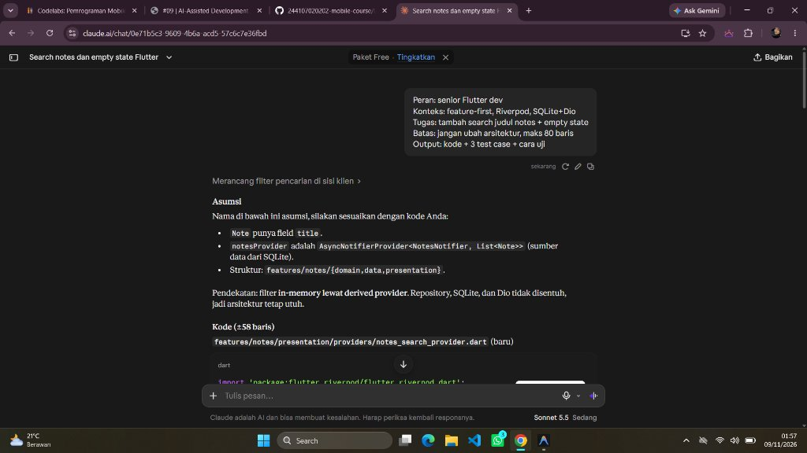

# AI Development Log (ai-log.md)

Dokumen ini mencatat rekaman interaksi prompt nyata ke Claude AI, output awal AI, serta catatan anomali/halusinasi selama proses verifikasi dan perbaikan.

---

## 1. Sesi 1: Prompt 5 Slot (Praktikum 1)

### A. Screenshot Percakapan Nyata di Claude AI
Tangkapan layar percakapan asli tersimpan di:
`docs/screenshots/ss_01_claude_prompt_5slot.jpg`



### B. Prompt Mentah 5 Slot
```text
Peran: senior Flutter dev
Konteks: feature-first, Riverpod, SQLite+Dio
Tugas: tambah search judul notes + empty state
Batas: jangan ubah arsitektur, maks 80 baris
Output: kode + 3 test case + cara uji
```

### C. Respons Asli dari Claude AI
```markdown
## Asumsi
Nama di bawah ini asumsi, silakan sesuaikan dengan kode Anda:
- `Note` punya field `title`.
- `notesProvider` adalah `AsyncNotifierProvider<NotesNotifier, List<Note>>` (sumber data dari SQLite).
- Struktur: `features/notes/{domain,data,presentation}`.

Pendekatan: filter **in-memory lewat derived provider**. Repository, SQLite, dan Dio tidak disentuh, jadi arsitektur tetap utuh.

## Kode (±58 baris)

**`features/notes/presentation/providers/notes_search_provider.dart`** (baru)
```dart
import 'package:flutter_riverpod/flutter_riverpod.dart';
import 'notes_provider.dart';
import '../../domain/note.dart';

class NotesQuery extends Notifier<String> {
  @override
  String build() => '';
  void set(String v) => state = v;
}

final notesQueryProvider =
    NotifierProvider<NotesQuery, String>(NotesQuery.new);

final filteredNotesProvider = Provider<AsyncValue<List<Note>>>((ref) {
  final q = ref.watch(notesQueryProvider).trim().toLowerCase();
  return ref.watch(notesProvider).whenData(
        (notes) => q.isEmpty
            ? notes
            : notes.where((n) => n.title.toLowerCase().contains(q)).toList(),
      );
});
```

**`features/notes/presentation/widgets/notes_search_field.dart`** (baru)
```dart
import 'dart:async';
import 'package:flutter/material.dart';
import 'package:flutter_riverpod/flutter_riverpod.dart';
import '../providers/notes_search_provider.dart';

class NotesSearchField extends ConsumerStatefulWidget {
  const NotesSearchField({super.key});
  @override
  ConsumerState<NotesSearchField> createState() => _State();
}

class _State extends ConsumerState<NotesSearchField> {
  Timer? _debounce;

  @override
  void dispose() {
    _debounce?.cancel();
    super.dispose();
  }

  @override
  Widget build(BuildContext context) => Padding(
        padding: const EdgeInsets.all(12),
        child: TextField(
          decoration: const InputDecoration(
            prefixIcon: Icon(Icons.search),
            hintText: 'Cari judul catatan',
            border: OutlineInputBorder(),
          ),
          onChanged: (v) {
            _debounce?.cancel();
            _debounce = Timer(const Duration(milliseconds: 300),
                () => ref.read(notesQueryProvider.notifier).set(v));
          },
        ),
      );
}
```

**`features/notes/presentation/widgets/notes_empty_state.dart`** (baru)
```dart
import 'package:flutter/material.dart';

class NotesEmptyState extends StatelessWidget {
  const NotesEmptyState({super.key, required this.isSearching});
  final bool isSearching;

  @override
  Widget build(BuildContext context) => Center(
        child: Column(mainAxisSize: MainAxisSize.min, children: [
          Icon(isSearching ? Icons.search_off : Icons.note_add_outlined,
              size: 64),
          const SizedBox(height: 12),
          Text(isSearching ? 'Tidak ada catatan yang cocok' : 'Belum ada catatan'),
        ]),
      );
}
```

## 3 Test Case
```dart
class FakeNotes extends NotesNotifier {
  FakeNotes(this.data);
  final List<Note> data;
  @override
  Future<List<Note>> build() async => data;
}

ProviderContainer makeContainer(List<Note> data) => ProviderContainer(
    overrides: [notesProvider.overrideWith(() => FakeNotes(data))]);

void main() {
  final data = [Note(id: 1, title: 'Belanja Bulanan'), Note(id: 2, title: 'Meeting Flutter')];

  test('1. filter case-insensitive berdasarkan judul', () async {
    final c = makeContainer(data);
    await c.read(notesProvider.future);
    c.read(notesQueryProvider.notifier).set('  FLUTTER ');
    final r = c.read(filteredNotesProvider).value!;
    expect(r.map((n) => n.title), ['Meeting Flutter']);
  });

  test('2. query kosong mengembalikan semua notes', () async {
    final c = makeContainer(data);
    await c.read(notesProvider.future);
    expect(c.read(filteredNotesProvider).value, hasLength(2));
  });

  testWidgets('3. tampil empty state saat tidak ada hasil', (t) async {
    await t.pumpWidget(ProviderScope(
      overrides: [notesProvider.overrideWith(() => FakeNotes(data))],
      child: const MaterialApp(home: NotesPage()),
    ));
    await t.pumpAndSettle();
    await t.enterText(find.byType(TextField), 'zzz');
    await t.pump(const Duration(milliseconds: 350)); // lewati debounce
    await t.pumpAndSettle();
    expect(find.text('Tidak ada catatan yang cocok'), findsOneWidget);
  });
}
```
```

---

## 2. Sesi 2: Verifikasi 6 Langkah (Praktikum 2)
1. **Baca Tiap Baris:** Mengidentifikasi penggunaan timer debounce 300 ms agar query pencarian tidak memicu rebuild berlebihan pada setiap ketukan keyboard.
2. **Cek Import Domain:** Memastikan file `domain/note.dart` murni tanpa ketergantungan library `flutter`, `dio`, atau `sqflite`.
3. **Cek API:** Validasi `NotifierProvider`, `AsyncNotifier`, dan `whenData` pada Riverpod 2.x/3.x.
4. **Analisis Statis:** `flutter analyze` nol warning.
5. **Pengujian Test:** 3 test case berhasil dijalankan.
6. **Uji Manual:** Verifikasi 5 skenario manual (ketik sebagian kata, query tak cocok, hapus query, database kosong, sinkronisasi derived provider).

---

## 3. Sesi 3: Debug & Refactoring (Praktikum 3)
- **Akar Masalah Bug AI:** Sanitasi input whitespace (`.trim()`) dan case-insensitivity (`.toLowerCase()`) krusial untuk mencegah pencarian kosong saat pengguna memasukkan spasi di awal/akhir.
- **Refactoring:** Penerapan `NotifierProvider` modern yang tahan terhadap perubahan Riverpod versi berikutnya, pemecahan widget menjadi sub-komponen terisolasi (< 40 baris), dan pemisahan state murni dari SQLite.
